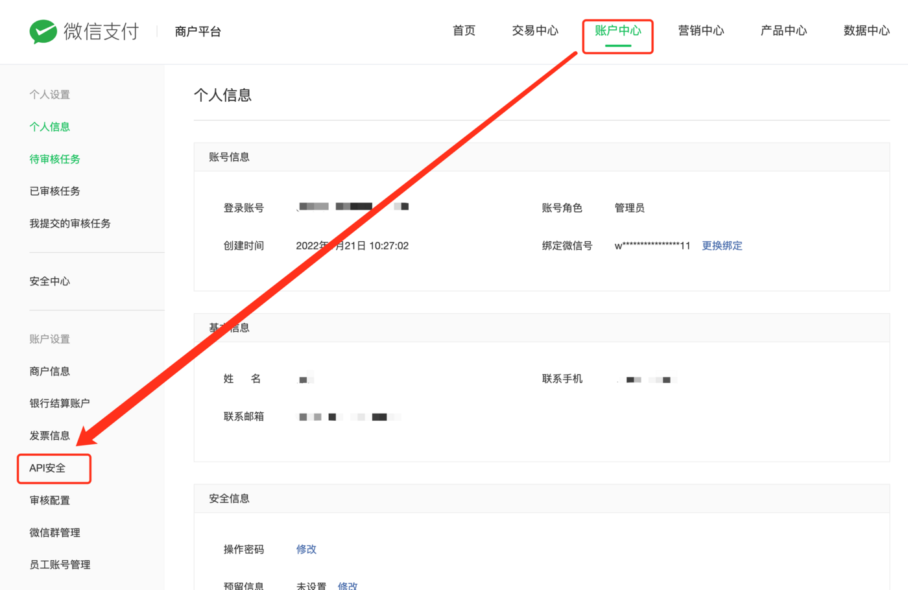
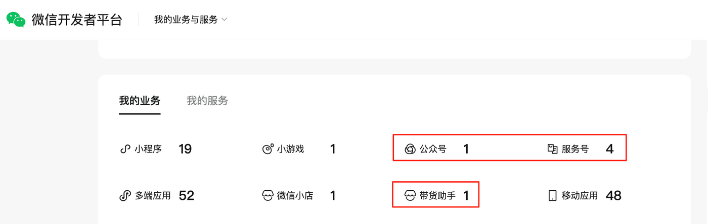
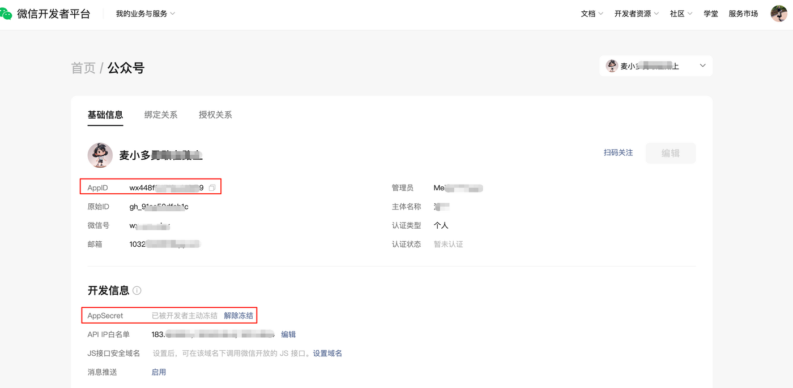
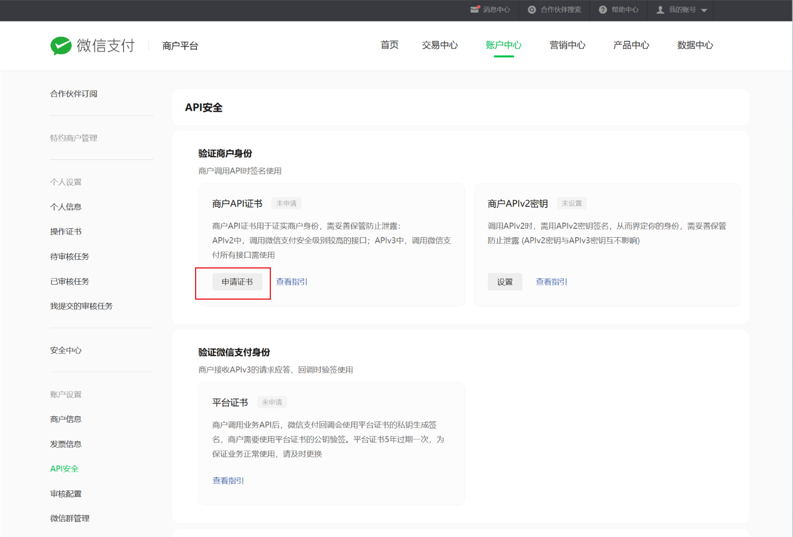
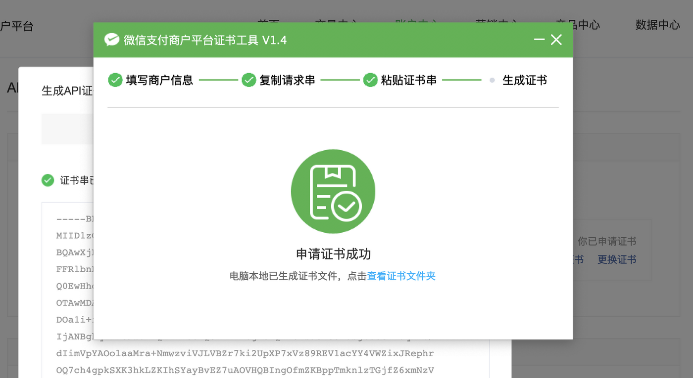
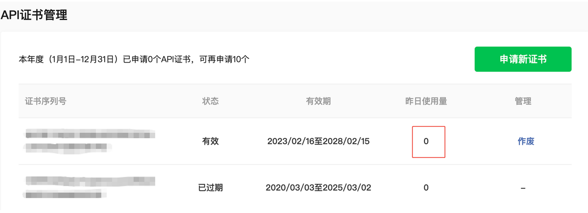

# 张文涛 · 个人主页

基于 **Next.js 16 + React 19 + TypeScript** 的独立个人主页，部署于火山引擎 IGA Pages。单页应用，包含 Live2D 形象、视差背景、打字机介绍、社交链接，以及「联系表单」与「微信 / 支付宝打赏」两项后端能力。

- 线上地址：<https://www.zhang-wentao.tech>
- 站点名称、域名、联系方式、社交链接等集中在 [`src/lib/site.ts`](src/lib/site.ts)，需要调整时只改这一处。

## 功能特性

- **首页形象**：Live2D 看板形象（WebGL 检测 + SDK 动态加载）、parallax-js 视差背景、打字机式自我介绍、全局自定义光标、首屏加载进度圈。
- **联系表单**：react-hook-form + zod 校验，收集姓名、邮箱与内容，提交后 POST JSON Webhook 通知站长，并可选并行推送 Bark，带 IP 限流与蜜罐反滥用。
- **打赏**：微信支付（Native / H5 / JSAPI）与支付宝（当面付 / 手机网站），无状态订单令牌，扫码二维码、轮询查单、回调验签后 Bark + Webhook 通知站长。
- **PWA**：可安装、离线页与静态资源缓存，适配 iOS 主屏幕（含各机型启动图）与桌面 WCO 窗口控件覆盖。
- **统计**：Umami 自建统计，隐私友好，含打赏收入事件上报。
- **WebMCP**：通过 `use-webmcp-tools` 暴露站点工具（如打开留言表单）。
- **SEO**：Metadata API、`robots.ts`、`sitemap.ts`、OG 分享图与结构化数据。

## 技术栈

| 领域 | 选型 |
| --- | --- |
| 框架 | Next.js 16（App Router / Turbopack）· React 19 · TypeScript 5 |
| 样式 | Tailwind CSS v4（@tailwindcss/postcss）· tw-animate-css · normalize.css |
| 动画 / 交互 | motion · parallax-js · pixi.js / @pixi/*（Live2D 渲染） |
| UI 组件 | Radix UI（Dialog / Label / Separator / Slot / Tooltip）· lucide-react · simple-icons |
| 表单 | react-hook-form · @hookform/resolvers · zod |
| 通知 | 通用 HTTP Webhook（fetch，Node Runtime） |
| 打赏 | qrcode（收款二维码）· 微信 APIv3 / 支付宝 RSA2 |
| 工具 | clsx · tailwind-merge · class-variance-authority |

运行环境要求 **Node.js 24+**（见 `package.json` 的 `engines`）。IGA Pages 构建环境支持 20 / 22 / 24，默认 20.x，本项目需在控制台选择 **24.x**。

## 快速开始

```bash
npm install
cp .env.local.example .env.local   # 然后填入真实凭证（见下文「环境变量」）
npm run dev                        # http://localhost:3000
```

类型检查与生产构建：

```bash
npm run type:check   # tsc --noEmit
npm run build        # next build（standalone 输出）
npm run start        # next start
```

## 部署到 IGA Pages

IGA Pages 支持 Next.js 14+ 的 SSR / API Routes，会自动识别本项目的 Next.js 框架并套用默认构建配置。本项目已做如下适配：

- `next.config.ts` 使用 `output: 'standalone'`，`images.unoptimized: true`（FaaS 运行时无法持久化图片优化缓存）。
- 根目录 [`iga.json`](iga.json) 固定安装与构建命令，优先级高于控制台构建配置。
- 构建产物不需要手动填写输出目录，由平台按 Next.js 模式处理。

### 控制台方式（首次使用推荐）

1. 登录[全站加速控制台](https://console.volcengine.com/dcdn) → **服务概览** → **Pages** → **创建项目**。
2. 代码源选择 GitHub 仓库（需先完成 GitHub 授权）或直接上传 ZIP；平台会自动识别为 Next.js。
3. 进入 **项目设置** → **Node.js 版本**，选择 `24.x`。平台默认是 `20.x`，而 `package.json` 要求 Node ≥ 24。
4. **项目设置** → **环境变量**：按下文「环境变量」逐项添加。`NEXT_PUBLIC_*` 会在构建时内联，修改后必须重新部署才生效。
5. **构建配置**保持默认即可（`npm run build`），或由 `iga.json` 覆盖；不要额外指定输出目录。
6. 首次部署完成后会生成 `xxx.preview.iga-pages.com` 预览域名，**仅 3 小时有效**，不适合正式对外。

### CLI 方式

```bash
npm install -g @iga-pages/cli          # 需要 Node.js >= 20

iga login                              # 浏览器登录；SSH/容器可用 iga login --remote；CI 用 --accessKey/--secretKey
iga pages link                         # 关联已有项目，或按提示创建新项目
iga pages dev                          # 本地启动，/api/* 由 Functions 代理
iga pages deploy                       # 构建并部署到 DCDN 加速网络
iga pages env pull                     # 将线上环境变量拉取到 .env.local
iga pages logs --since 1h --level error # 查看运行时日志
iga pages preview                      # 获取带访问凭证的预览地址
```

说明：

- `iga pages dev` 会读取 `package.json` 的 `dev` 命令，请勿把 `dev` 改成 `iga pages dev`。
- Next.js 的 API Routes 由 Next 运行时处理，**不需要**在根目录再建 `api/` 目录；`api/` 目录只用于非 Next.js 项目的 Functions。
- 关联了 GitHub 仓库的项目，`iga pages deploy` 会优先从仓库拉取代码构建；未授权时会退化为上传 ZIP（上限 1024 MB）。
- 单项目最多保留 10 个部署版本，超出后自动删除最早版本。

### 自定义域名与加速

1. 控制台进入项目 → **域名管理** → 添加域名，按提示配置 **TXT 验证** 与 **CNAME 解析**。
2. 中国大陆加速区域要求域名完成 ICP 备案；HTTPS 证书可在平台申请或上传。
3. 建议同时绑定根域与 `www`：`next.config.ts` 会把根域 308 重定向到 `SITE_URL`（当前为 `https://www.zhang-wentao.tech`）。
4. 域名解析生效后，`SITE_URL`、支付回调地址（`WECHAT_NOTIFY_URL` / `ALIPAY_NOTIFY_URL`）需与正式域名保持一致。

### 用 AI 编程客户端对接（可选）

- **Plugin（Skill + Pages MCP + 开发提醒一次装好）**：`npx plugins add volc-iga-pages/iga-pages-plugin`
- **仅 MCP**：在 AI 客户端的 MCP 配置中加入远程端点，并完成 OAuth 授权：

```json
{
  "mcpServers": {
    "volcengine-mcp": {
      "url": "https://iga-pages.mcp.volcbiz.com/mcp"
    }
  }
}
```

Plugin 与 MCP 只负责查询/操作 IGA Pages 项目、环境变量、部署与日志；本地构建、`dev`、`deploy` 仍需安装 IGA CLI。CLI 登录（`iga login`）与 MCP OAuth 授权相互独立。

## 目录结构

```
src/
├── app/                         # App Router
│   ├── layout.tsx               # 根布局（metadata、字体、首屏显示模式脚本）
│   ├── page.tsx                 # 首页
│   ├── globals.css              # 样式入口
│   ├── error.tsx / not-found.tsx
│   ├── manifest.ts              # PWA manifest
│   ├── robots.ts / sitemap.ts   # SEO
│   └── api/
│       ├── donate/              # 打赏接口（见「打赏」章节）
│       │   ├── config/route.ts
│       │   ├── create/route.ts
│       │   ├── status/route.ts
│       │   ├── notify/[channel]/route.ts
│       │   └── wechat/oauth/{route.ts,callback/route.ts}
│       └── contact/route.ts    # 联系表单 → Webhook 通知（Node Runtime）
├── assets/                      # svg、webp 静态资源
├── components/                  # 通用 UI 与全局组件（ui、preloader、交互守卫）
├── features/
│   ├── home/                    # 首页组装、视差背景、自定义光标、页头页脚
│   ├── avatar/                  # 头像与 Live2D（components、live2d）
│   ├── profile/                 # 名称、描述、社交 / 打赏 / 联系链接
│   ├── contact/                 # 联系表单（client、server）
│   ├── donate/                  # 打赏（client、server、alipay、wechat）
│   ├── pwa/                     # Service Worker 注册
│   └── webmcp/                  # WebMCP 工具（use-webmcp-tools）
├── hooks/  lib/  utils/  types/ # 通用 hooks、站点配置、工具、类型
└── styles/                      # 全局样式与 Tailwind 主题
public/                          # live2d 模型、字体、图标、iOS 启动图、文档配图
```

## 站点配置

[`src/lib/site.ts`](src/lib/site.ts) 集中管理站点元信息，会被客户端组件引用，**切勿写入任何密钥**：

- 站点：`SITE_URL`、`SITE_NAME`、`SITE_DESCRIPTION`、`SITE_AUTHOR_NAME`、`SITE_SIGNATURE`
- 联系：`CONTACT_EMAIL`（默认 `mine@139.com`）
- 社交：`SITE_SOCIAL_LINKS`（blog / github，留空时对应入口置灰不可点）
- 备案：`ICP_NUMBER` / `ICP_LINK`（未配置时使用默认备案号，显式置空则隐藏）
- 打赏：`DONATION_MIN_AMOUNT` / `DONATION_MAX_AMOUNT`（默认 1–10000 元）、`DONATION_SUBJECT`
- 统计：`SITE_ANALYTICS_URL` / `SITE_ANALYTICS_WEBSITE_ID` / `SITE_ANALYTICS_DOMAINS`

## 环境变量

在 `.env.local`（本地）或 IGA Pages 的环境变量设置（线上）配置，**修改后需重新部署**。真实密钥切勿提交到 Git，`.env.local` 已在 `.gitignore` 中。

### 通知 Webhook（联系表单 / 打赏）

| 变量 | 必填 | 说明 |
| --- | --- | --- |
| `NOTIFY_WEBHOOK_URL` | 是 | 接收 POST JSON 的 HTTP(S) 地址 |
| `NOTIFY_WEBHOOK_SECRET` | 否 | 设置后以 `Authorization: Bearer <secret>` 发送 |
| `NOTIFY_WEBHOOK_FALLBACK_URL` | 否 | 主 Webhook 失败时接收失败事件的备用地址 |
| `NOTIFY_WEBHOOK_FALLBACK_SECRET` | 否 | 失败 Webhook 的独立令牌，留空复用 `NOTIFY_WEBHOOK_SECRET` |

联系表单请求体：

```json
{
  "type": "contact",
  "title": "收到一条新的留言",
  "site": { "name": "站点名称", "url": "https://www.zhang-wentao.tech" },
  "name": "访客姓名",
  "email": "访客邮箱",
  "content": "留言内容",
  "timestamp": "2026-01-01T00:00:00.000Z"
}
```

打赏请求体：

```json
{
  "type": "donation",
  "title": "收到一笔新打赏",
  "site": { "name": "站点名称", "url": "https://www.zhang-wentao.tech" },
  "channel": "微信支付",
  "amount": "10.00",
  "orderId": "订单号",
  "timestamp": "2026-01-01T00:00:00.000Z"
}
```

失败 Webhook 请求体（主 Webhook 返回非 2xx、网络错误或超时后触发；`type` 为「原始事件类型 + `.webhook_failed`」，留言与打赏均覆盖）：

```json
{
  "type": "contact.webhook_failed",
  "title": "Webhook 投递失败",
  "site": { "name": "站点名称", "url": "https://www.zhang-wentao.tech" },
  "error": "Webhook 返回 500",
  "original": { "type": "contact", "name": "访客姓名", "content": "留言内容" },
  "timestamp": "2026-01-01T00:00:00.000Z"
}
```

打赏失败时 `original` 携带完整打赏信息，便于定位是哪一笔：

```json
{
  "type": "donation.webhook_failed",
  "title": "Webhook 投递失败",
  "site": { "name": "站点名称", "url": "https://www.zhang-wentao.tech" },
  "error": "Webhook 业务处理失败（HTTP 200）：errcode 310000",
  "original": { "type": "donation", "channel": "微信支付", "amount": "10.00", "orderId": "订单号" },
  "timestamp": "2026-01-01T00:00:00.000Z"
}
```

机器人（飞书 / 钉钉 / 企微）接收失败事件时，消息体会同时渲染错误原因与原始事件的关键字段（留言的姓名/邮箱/内容，或打赏的渠道/金额/订单号）；通用接收端则原样收到含 `original` 的完整 JSON。

约定：单次请求 8 秒超时。通用接收端（自建服务、n8n、Make、Zapier 等）返回 2xx 即视为成功；主 Webhook 失败后自动尝试 `NOTIFY_WEBHOOK_FALLBACK_URL`，失败 Webhook 成功则整体视为通知成功，两者都失败才返回 `502`。Webhook 地址只放在服务端环境变量，不要暴露给前端。

**飞书 / 钉钉 / 企业微信群机器人**：会按 webhook 域名自动识别，并把通用 JSON 转换成对应协议的消息体（飞书 `interactive` 卡片、钉钉 / 企微 `markdown`），无需额外配置。这类机器人在 payload 格式错误、签名校验失败或关键词不匹配时，通常仍返回 HTTP 200 但 body 中 `code` / `errcode` 非 0；现在会被判定为投递失败（触发失败 Webhook 或返回 `502`），真实原因写入服务端日志（`iga pages logs --since 1h`），不再静默误报成功。如果机器人开启了「签名校验」，需在机器人前加一层转换服务处理签名，或暂时关闭签名校验。

### Bark 推送（收到留言 / 打赏时通知 iPhone，可选）

| 变量 | 必填 | 说明 |
| --- | --- | --- |
| `BARK_DEVICE_KEY` | 否 | Bark App 中的设备 key，留空则不推送 |
| `BARK_SERVER_URL` | 否 | 自建 Bark 服务端，留空用官方 `https://api.day.app` |

### 打赏（微信支付 / 支付宝 / 订单签名）

见下文「打赏」章节的完整环境变量表与获取方式（含官方配图）。核心变量：`DONATION_ORDER_SECRET`、`WECHAT_*`、`ALIPAY_*`。

### 其他

| 变量 | 必填 | 说明 |
| --- | --- | --- |
| `NEXT_PUBLIC_ICP_NUMBER` | 否 | 页脚备案号；不配置时用 `site.ts` 默认值，显式置空则隐藏 |
| `NEXT_PUBLIC_ICP_LINK` | 否 | 备案查询链接，默认工信部备案系统 |
| `NEXT_ALLOWED_DEV_ORIGINS` | 否 | 逗号分隔的开发预览来源，供 `next.config.ts` 的 `allowedDevOrigins` 使用（预览沙箱代理域名） |

> `NEXT_PUBLIC_*` 会在构建时内联，修改后必须重新部署。

## 联系表单（Webhook）

提交表单后，[`src/app/api/contact/route.ts`](src/app/api/contact/route.ts) 会：

1. 校验姓名、邮箱与内容，POST JSON 到 `NOTIFY_WEBHOOK_URL`；主 Webhook 失败时自动投递失败事件到 `NOTIFY_WEBHOOK_FALLBACK_URL`，两者都失败才返回 `502`。
2. 并行推送 Bark（可选），Bark 失败只记日志，不影响提交结果。
3. 不再向访客发送确认邮件，访客只会看到页面内的成功提示。

反滥用：每个来源 IP 10 分钟最多提交 5 次，超限返回 `429` 与 `Retry-After`；含隐藏蜜罐字段，请求体限制 24 KiB。速率记录保存在 Node 进程内存中，多实例间不共享；如需全局精确限流，应接入共享存储（如 Redis）或部署平台 WAF。

运行约束（已在代码中落实）：

- 使用 `export const runtime = 'nodejs'`，`fetch` 走标准 HTTP(S) 出网。
- Webhook 超时 8 秒，接收端返回 2xx 才算成功；主 Webhook 失败时会尝试失败 Webhook。
- 联系表单会等待 Webhook 完成后才返回，避免请求提前结束导致通知丢失。

## 打赏（微信支付 / 支付宝）

内置微信支付与支付宝打赏，采用**无状态订单**：服务端不落库、不依赖 Redis，下单时把订单号、渠道、金额签成 `statusToken`，查单时验签还原后直接向支付平台查询。回调只做验签/解密并触发通知，不写库。

### 设计概览

```
前端 ──POST /api/donate/create──> 服务端 ──下单──> 微信/支付宝网关
前端 <──statusToken + (codeUrl|redirectUrl|payment)── 服务端
前端 ──轮询 GET /api/donate/status?token──> 服务端 ──查单──> 网关
前端 <──{ status: pending|paid|closed }── 服务端
网关 ──异步回调──> /api/donate/notify/[channel] ──验签/解密──> Bark + Webhook 通知站长
```

关键决策：

- **不落库**：订单信息以签名令牌发给前端，查单时还原，省去数据库。
- **查单为准**：支付结果以前端携带令牌主动查询网关为准，回调仅触发通知，即使回调丢失也不影响结果确认。
- **密钥边界**：商户密钥只在服务端环境变量读取，客户端只持有 `statusToken`，无法篡改金额。

### 无状态订单令牌 `statusToken`

实现见 [`server/token.ts`](src/features/donate/server/token.ts)。

- 算法：HMAC-SHA256。密钥优先取 `DONATION_ORDER_SECRET`；未配置时从支付私钥（微信 `WECHAT_PRIVATE_KEY` 或支付宝 `ALIPAY_PRIVATE_KEY`）派生，派生源为稳定环境变量，跨实例一致，无需手动配置。
- 结构：`<base64url(payload)>.<base64url(signature)>`。
- 载荷短字段：`v`（版本=1）、`e`（过期 Unix 秒，签发 +3600）、`o`（订单号）、`c`（渠道）、`a`（金额分）。
- 校验：`timingSafeEqual` 防时序攻击，并校验版本、过期、渠道枚举、订单号非空、金额为正整数。
- 修改 `DONATION_ORDER_SECRET` 会使已签发未支付的令牌立即失效（不影响已完成支付）。

### 接口契约

所有路由位于 [`src/app/api/donate/`](src/app/api/donate)，运行时 `nodejs`、`force-dynamic`。config / create / status 的错误响应统一为 `{ "error": { "code": "...", "message": "..." } }`；支付回调按平台协议返回：支付宝纯文本 `success` / `failure`，微信 `{ "code": "...", "message": "..." }`。

| 路由 | 方法 | 说明 |
| --- | --- | --- |
| `/api/donate/config` | GET | 返回各渠道是否已配置、`wechatJsapi` 是否可用 |
| `/api/donate/create` | POST | 下单，按渠道/环境返回 `codeUrl` / `redirectUrl` / `payment` + `statusToken` |
| `/api/donate/status?token=` | GET | 验签后向网关查单，返回 `pending` / `paid` / `closed` |
| `/api/donate/notify/wechat` · `/notify/alipay` | POST | 支付平台异步回调，验签/解密后触发站长通知 |
| `/api/donate/wechat/oauth` · `/oauth/callback` | GET | 微信内 JSAPI 静默授权获取 openid（`snsapi_base`），写入防篡改 Cookie |

下单请求体：`{ "channel": "wechat" | "alipay", "amount": 整数元, "mode": "native" | "jsapi"(可选) }`，成功返回 `201`。

错误码：`400 BAD_REQUEST`、`401 WECHAT_OAUTH_REQUIRED`、`404 INVALID_ORDER`、`502 GATEWAY_FAILED`、`503 GATEWAY_NOT_CONFIGURED`。

### 支付方式选择

| 渠道 | 运行环境 | 调用能力 | 返回字段 |
| --- | --- | --- | --- |
| 微信 | 桌面浏览器 | `transactions/native` | `codeUrl` |
| 微信 | 微信外手机浏览器 | `transactions/h5` | `redirectUrl` |
| 微信 | 微信内 + 已配置 `WECHAT_APP_SECRET` | `transactions/jsapi`（需 openid） | `payment` |
| 支付宝 | 桌面浏览器 | `alipay.trade.precreate`（当面付） | `codeUrl` |
| 支付宝 | 手机浏览器 | `alipay.trade.wap.pay`（手机网站） | `redirectUrl` |

> 微信内未配置 JSAPI 时，前端提示「请在浏览器中打开后支付」并禁用下单（微信 WebView 会拦截 H5 支付）。

### 环境变量

| 变量 | 必填 | 说明 / 获取位置 |
| --- | --- | --- |
| `DONATION_ORDER_SECRET` | 可选 | 订单令牌签名密钥；留空自动从支付私钥派生，无需手动配置 |
| `WECHAT_MCH_ID` | 微信必填 | 微信支付商户号 |
| `WECHAT_APP_ID` | 微信必填 | 与商户号绑定的 AppID |
| `WECHAT_API_V3_KEY` | 微信必填 | 32 位 APIv3 密钥，用于回调解密 |
| `WECHAT_CERT_SERIAL_NO` | 微信必填 | 商户 API 证书序列号 |
| `WECHAT_PRIVATE_KEY` | 微信必填 | `apiclient_key.pem` 内容，换行写成 `\n` |
| `WECHAT_PUBLIC_KEY_ID` | 微信必填 | 微信支付公钥 ID（公钥模式） |
| `WECHAT_PUBLIC_KEY` | 微信必填 | 微信支付公钥内容，换行写成 `\n`，用于回调验签 |
| `WECHAT_APP_SECRET` | 可选 | 公众号 AppSecret；存在时微信内才走 JSAPI |
| `WECHAT_NOTIFY_URL` | 可选 | 默认 `${SITE_URL}/api/donate/notify/wechat` |
| `ALIPAY_APP_ID` | 支付宝必填 | 开放平台应用 AppID |
| `ALIPAY_PRIVATE_KEY` | 支付宝必填 | 应用私钥（RSA2），换行写成 `\n` |
| `ALIPAY_PUBLIC_KEY` | 支付宝必填 | 支付宝公钥（非应用公钥），用于回调验签 |
| `ALIPAY_GATEWAY` | 可选 | 默认 `https://openapi.alipay.com/gateway.do` |
| `ALIPAY_NOTIFY_URL` | 可选 | 默认 `${SITE_URL}/api/donate/notify/alipay` |

两个回调地址必须是公网可达的 HTTPS 地址。

#### 微信支付各变量获取方式（附图）

以下路径取自微信支付官方文档 [开发必要参数说明](https://pay.weixin.qq.com/doc/v3/merchant/4013070756)。密钥类变量多数**设置后不可再次查看**，请当场复制保存。截图来自官方文档，实际页面以商户平台为准。

配置总入口：登录 [微信商户平台](https://pay.weixin.qq.com/) → 顶部「账户中心」→ 左侧「API 安全」。



**`DONATION_ORDER_SECRET`**（可选）—— 留空即自动从支付私钥派生，通常无需配置；如需显式指定可自行生成：

```bash
openssl rand -hex 32
# 或：node -e "console.log(require('crypto').randomBytes(32).toString('hex'))"
```

**`WECHAT_MCH_ID`** —— 商户号：商户平台「账户中心 → 商户信息」查看（登录后页面顶部也会显示）。

**`WECHAT_APP_ID` 与 `WECHAT_APP_SECRET`** —— 公众号 / 服务号：前往 [微信开发者平台](https://developers.weixin.qq.com/platform/) 扫码登录 → 「我的业务 → 公众号/服务号」→ 详情页 → 「基础信息」查看 AppID 与 AppSecret。





> AppSecret 平台不储存明文，忘记需点「重置」重新生成（旧密钥立即失效），重置弹窗中可复制明文：


> 旧入口仍可在 [微信公众平台](https://mp.weixin.qq.com/) →「设置与开发 → 开发接口管理 → 基本配置」找到。AppID 必须与商户号完成绑定才能下单。

**`WECHAT_API_V3_KEY`** —— 32 位 APIv3 密钥：「API 安全」页底部「APIv3 密钥」→「设置」。**设置后无法查看**，遗失须重新设置。


**`WECHAT_CERT_SERIAL_NO` 与 `WECHAT_PRIVATE_KEY`** —— 商户 API 证书（二者配套）：

1. 「API 安全」→「商户 API 证书」→「申请证书」。

   

2. 按提示下载「微信支付证书工具」，本地生成证书文件：`apiclient_key.pem` 为私钥、`apiclient_cert.pem` 为证书。证书**只能下载一次**，遗失须重新申请。

   

3. 提交证书串后，在「API 证书管理」列表的「证书序列号」列查看序列号填入 `WECHAT_CERT_SERIAL_NO`；把 `apiclient_key.pem` 全文（换行写成 `\n`）填入 `WECHAT_PRIVATE_KEY`。

   

**`WECHAT_PUBLIC_KEY_ID` 与 `WECHAT_PUBLIC_KEY`** —— 微信支付公钥（公钥模式，长期有效无需定期更换）：

1. 「API 安全」→「微信支付公钥」→「管理公钥」。

   

2. 列表查看「公钥 ID」填入 `WECHAT_PUBLIC_KEY_ID`；「下载公钥」得到 `.pem`，其全文（换行写成 `\n`）填入 `WECHAT_PUBLIC_KEY`。

   

### 微信支付接入详解

实现见 [`server/wechat/`](src/features/donate/server/wechat)，请求发往 `https://api.mch.weixin.qq.com`，使用 APIv3。

- **请求签名**：每次请求带 `Authorization: WECHATPAY2-SHA256-RSA2048 mchid=...,nonce_str=...,signature=...,timestamp=...,serial_no=...`。签名串 `METHOD\nURL_PATH\nTIMESTAMP\nNONCE\nBODY\n`，用商户私钥做 RSA-SHA256 后 base64。
- **下单**：Native 返回 `code_url`；H5 额外带 `scene_info`，返回 `h5_url` 并追加 `redirect_url` 回跳站点；JSAPI 返回 `prepay_id`，二次签名生成前端调起参数 `{ appId, timeStamp, nonceStr, package, signType:'RSA', paySign }`。
- **查单**：`GET /v3/pay/transactions/out-trade-no/{out_trade_no}?mchid=...`，`SUCCESS/REFUND→paid`、`CLOSED/REVOKED/PAYERROR→closed`、其他→`pending`。
- **回调验签解密**：校验 `wechatpay-serial` 等于公钥 ID、时间戳偏差 ≤300s，用公钥对 `timestamp\nnonce\nbody\n` 验签，再用 `WECHAT_API_V3_KEY` 做 `AEAD_AES_256_GCM` 解密，`trade_state===SUCCESS` 时触发通知并返回 `{ "code": "SUCCESS" }`。

### 支付宝接入详解

实现见 [`server/alipay/`](src/features/donate/server/alipay)，走 `ALIPAY_GATEWAY`，RSA2 签名、表单提交。

- **签名**：公共参数 + `biz_content`，按键名 ASCII 升序拼接（剔除空值与 `sign`），用应用私钥 `SHA256withRSA` 后 base64 作为 `sign`。
- **下单**：当面付 `alipay.trade.precreate` 返回 `qr_code`；手机网站 `alipay.trade.wap.pay` 构造签名后的完整网关 URL（含 `return_url` / `quit_url`）返回前端跳转。
- **查单**：`alipay.trade.query`，`TRADE_SUCCESS/TRADE_FINISHED→paid`、`TRADE_CLOSED→closed`、其他→`pending`。
- **回调验签**：用支付宝公钥对参数（剔除 `sign`/`sign_type`）验签，校验 `app_id`，`TRADE_SUCCESS/TRADE_FINISHED` 时触发通知并返回纯文本 `success`。

### 回调后的站长通知

回调验签通过后，[`server/notify.ts`](src/features/donate/server/notify.ts) 的 `notifyDonationSuccess` 并行执行：

- **Bark 推送**（[`lib/bark.ts`](src/lib/bark.ts)）：需 `BARK_DEVICE_KEY`，点击通知打开站点首页。
- **Webhook 通知**（[`webhook.ts`](src/features/contact/server/webhook.ts)）：POST 渠道、金额、订单号到 `NOTIFY_WEBHOOK_URL`。

任一通知失败只记日志，不影响回调返回成功，避免支付平台重复投递；未配置时自动跳过。

### 前端支付流程

见 [`client/donate-dialog.tsx`](src/features/donate/client/donate-dialog.tsx) 与 [`client/revenue.ts`](src/features/donate/client/revenue.ts)：

1. 打开弹窗 → `GET /api/donate/config` 决定可用渠道。
2. 输入金额 → `POST /api/donate/create`：扫码用 `codeUrl` 渲染二维码并每 3 秒轮询查单（最长 5 分钟）；跳转打开 `redirectUrl`，支付后回跳 `/?donate=success&token=...` 再查单确认；JSAPI 用 `payment` 调起收银台后轮询确认。
3. 状态变 `paid` → 前端上报 Umami 收入事件，并按订单号去重。

### 开通步骤

**微信支付**：开通 Native / H5 / JSAPI（按需）；配置 H5 支付域名；「API 安全」设置 APIv3 密钥、下载商户证书记录序列号与私钥；切换公钥模式填入公钥 ID 与公钥；JSAPI 需配置公众号网页授权域名与 `WECHAT_APP_SECRET`；确保回调地址公网 HTTPS 可达。

**支付宝**：开放平台创建应用并签约当面付与手机网站支付；生成 RSA2 密钥对，上传应用公钥并保存支付宝公钥；填入 `ALIPAY_APP_ID` / `ALIPAY_PRIVATE_KEY` / `ALIPAY_PUBLIC_KEY`；确认应用已上线且签约能力生效。

### 注意事项

- 所有密钥只放服务端环境变量，切勿写入 `site.ts`、客户端组件或提交到 Git。
- 回调只负责验签与触发通知；即使回调丢失，前端查单仍能确认支付结果。
- `statusToken` 有效期 1 小时，超时无法查单，但支付平台侧订单不受影响。
- 收入统计由前端在确认支付后上报；用户支付后直接关闭页面则不会产生该次统计。
- 更换 `DONATION_ORDER_SECRET`、微信/支付宝密钥后必须重新部署。
- 未显式配置 `DONATION_ORDER_SECRET` 时密钥派生自支付私钥，更换支付私钥会使进行中的旧令牌失效（已完成的支付不受影响）。

## PWA 与 iOS 主屏幕

- manifest 由 [`src/app/manifest.ts`](src/app/manifest.ts) 生成，Service Worker 由 [`features/pwa/service-worker-registration.tsx`](src/features/pwa/service-worker-registration.tsx) 注册，`next.config.ts` 对 `/sw.js` 禁缓存。
- iOS 26 / iPadOS 26 起，添加到主屏幕的网站**默认以 Web 应用打开**；manifest 仍决定图标、名称、启动图、主题色等外观。旧系统（iOS 16.4–18）仍依赖 `display: standalone` 与 `apple-mobile-web-app-capable`，两者均保留。
- `viewportFit: 'cover'` 配合 `env(safe-area-inset-*)` 使用，样式在 [`src/styles/index.css`](src/styles/index.css) 定义 `--safe-top` / `--safe-bottom`，页头、页脚与弹窗据此留白；桌面 WCO 模式改用 `env(titlebar-area-*)`。
- `public/launch/` 内置各机型 iOS 启动图。

## 常见问题

- **留言/打赏通知返回 502**：检查 `NOTIFY_WEBHOOK_URL` 是否可访问、接收端是否返回 2xx、是否在 8 秒内响应；如设置了密钥，确认接收端校验了 `Authorization: Bearer`。若配置了 `NOTIFY_WEBHOOK_FALLBACK_URL`，两者都失败才会返回 502。若接收端是飞书 / 钉钉 / 企微机器人，执行 `iga pages logs --since 1h` 查看日志中的 `code` / `errcode`，据此判断是消息格式、签名校验还是自定义关键词问题。
- **Bark 没收到推送**：检查 `BARK_DEVICE_KEY` 与 `BARK_SERVER_URL`；Bark 失败不会影响留言提交。
- **Live2D 不显示**：确认 `public/live2d/` 目录（含 `live2dcubismcore.min.js` 与 `character/` 模型）已完整部署，且浏览器支持 WebGL。
- **打赏下单 502 / 网关错误**：检查密钥格式（`\n` 是否还原）、证书序列号、AppID 与商户号绑定、支付宝应用是否上线。
- **打赏回调 401**：微信公钥 ID/公钥错误或时间戳偏差；支付宝公钥误填成应用公钥。
