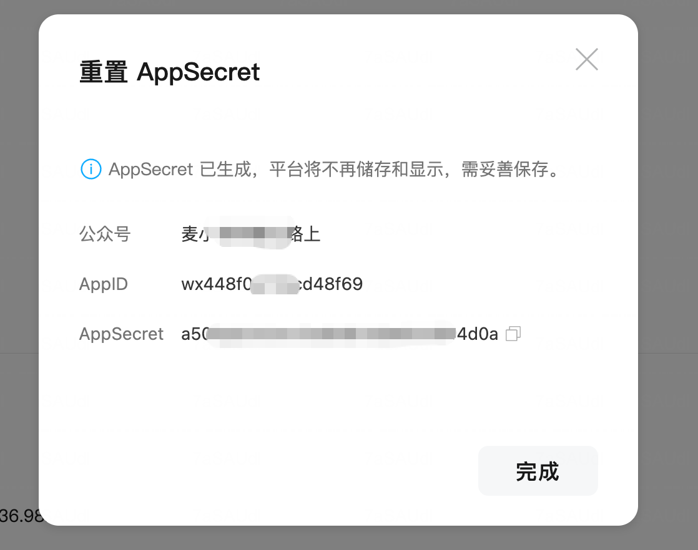
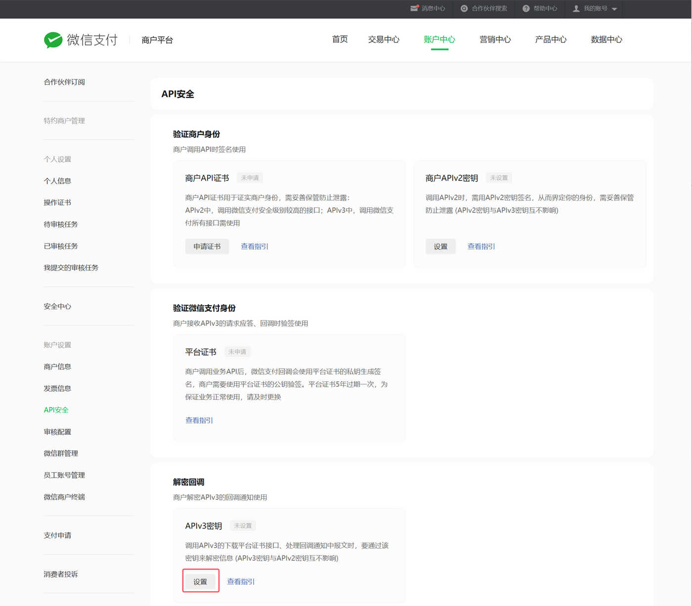
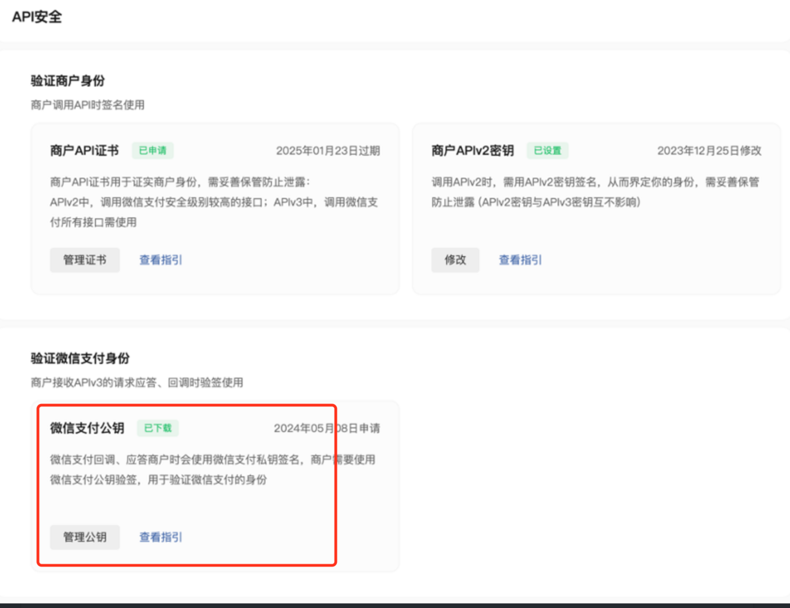
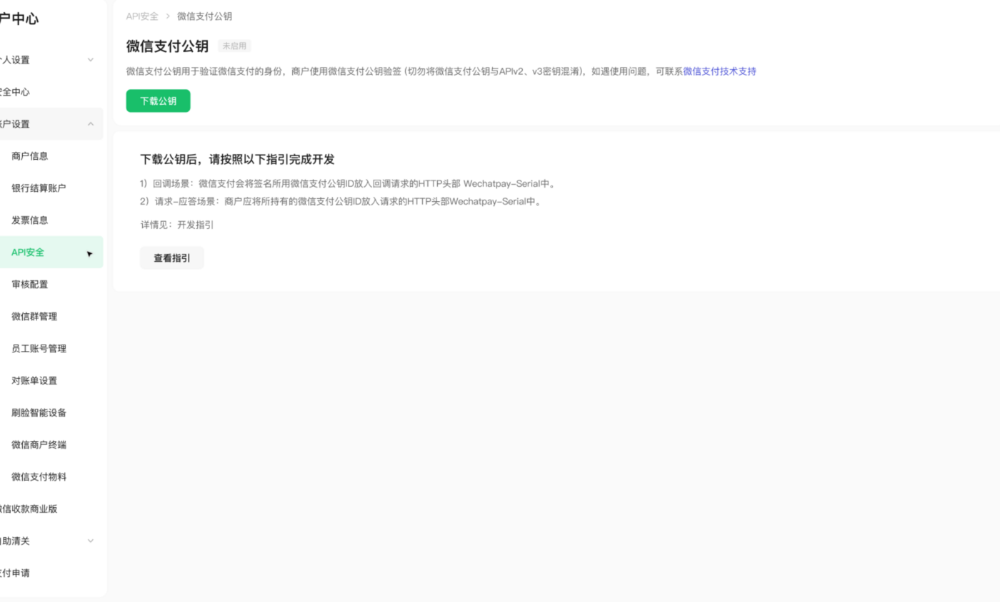

# 张文涛 · 个人主页

基于 **Next.js 16 + React 19 + TypeScript** 的独立个人主页，境内走火山引擎 IGA Pages，境外走 Vercel（push 到 GitHub 镜像仓库 `main` 自动构建）。

- 线上地址：<https://www.zhang-wentao.tech>
- CDN 缓存与国内外分流的完整配置、验证与排障：[CDN-AND-GEO-ROUTING.md](CDN-AND-GEO-ROUTING.md)

## 功能特性

- **首页形象**：Live2D 看板形象（WebGL 检测 + SDK 动态加载）、视差背景、打字机式自我介绍、全局自定义光标、首屏加载进度圈
- **联系表单**：react-hook-form + zod 校验，POST JSON Webhook 通知，带 IP 限流与蜜罐反滥用
- **打赏**：微信支付（Native/H5/JSAPI）与支付宝（当面付/手机网站），无状态订单令牌，扫码二维码、轮询查单、回调验签后通知站长
- **PWA**：可安装、离线页与静态资源缓存，适配 iOS 主屏幕与桌面 WCO
- **统计**：Umami 自建统计（隐私友好），Vercel 部署时额外注入 Vercel Analytics 与 Speed Insights
- **SEO**：Metadata API、robots.ts、sitemap.ts、OG 分享图与结构化数据

## 技术栈

| 领域 | 选型 |
|------|------|
| 框架 | Next.js 16（App Router / Turbopack）· React 19 · TypeScript 5 |
| 样式 | Tailwind CSS v4 · tw-animate-css · normalize.css |
| 动画/交互 | motion · parallax-js · pixi.js（Live2D 渲染） |
| UI 组件 | Radix UI · lucide-react · @icons-pack/react-simple-icons |
| 表单 | react-hook-form · @hookform/resolvers · zod |
| 通知 | 通用 HTTP Webhook · 飞书/钉钉/企微机器人协议适配 |
| 打赏 | qrcode · 微信 APIv3 / 支付宝 RSA2 |
| 部署 | 火山引擎 IGA Pages（standalone）· Vercel（GitHub 镜像 Git 集成自动发布，CLI 可手动补发） |

**运行环境要求 Node.js 24+**（见 `package.json` 的 `engines`）

## 快速开始

```bash
npm install
cp .env.local.example .env.local   # 填入真实凭证
npm run dev                        # http://localhost:3000
```

类型检查、代码检查与生产构建：

```bash
npm run type:check        # tsc --noEmit
npm run lint              # eslint .
npm run build             # next build（standalone 输出）
npm run start             # next start
npm run start:standalone  # 按 standalone 产物启动
```

## 项目结构

```
src/
├── app/                          # App Router 入口
│   ├── api/                      # Route Handlers
│   │   ├── contact/              # 联系表单 → Webhook 通知
│   │   └── donate/               # 打赏接口（创建/查询/回调）
│   ├── layout.tsx / page.tsx     # 根布局与首页
│   ├── globals.css               # 样式入口
│   └── manifest.ts / robots.ts   # PWA / SEO
├── components/                   # 通用 UI（shadcn 风格）
├── features/                     # 按业务域组织，每个域的文件平铺，不套空目录
│   ├── home/                     # 首页、视差背景、自定义光标
│   ├── avatar/                   # Live2D 头像（PixiJS 运行时单独放 live2d/）
│   ├── profile/                  # 名称、描述、社交链接
│   ├── contact/                  # 联系表单
│   ├── donate/                   # 打赏（支付渠道实现集中在 server/）
│   └── pwa/                      # Service Worker 注册
├── hooks/                        # 通用 React hooks
├── lib/                          # 站点工具（日志、通知、限流）
├── proxy.ts                      # 裸域自动补 www + 国内外分流
└── styles/                       # 全局样式与 Tailwind 主题
public/                           # Live2D 模型、字体、图标、iOS 启动图、文档配图
site.config.ts                    # 站点全局配置
```

## 站点配置

所有站点配置集中在 `site.config.ts`：

```ts
import { SITE_URL, SITE_GEO_ROUTING } from '~/site.config';
```

| 分区 | 导出 | 作用 |
|------|------|------|
| 域名 | `SITE_URL` | 站点正式地址，canonical、metadataBase、sitemap 等派生 |
| 部署与分流 | `SITE_DEPLOY_TARGETS` | IGA Pages 与 Vercel 平台地址 |
| 文案 | `SITE_NAME` / `SITE_DESCRIPTION` / `SITE_SIGNATURE` | 标题、描述、打字机副标题 |
| 打赏 | `DONATION_MIN_AMOUNT` / `DONATION_MAX_AMOUNT` | 单笔金额上下限 |
| 统计 | `SITE_ANALYTICS_URL` / `SITE_ANALYTICS_WEBSITE_ID` | Umami 配置 |
| CDN | `SITE_CDN_CACHE` | 四档缓存策略（immutable/static/serviceWorker/api），详见 [CDN 与分流配置指南](CDN-AND-GEO-ROUTING.md) |

**公开信息进文件，密钥进环境变量**。`site.config.ts` 被客户端组件引用，切勿写入任何密钥。

## 环境变量

密钥类变量放在 `.env.local`（本地）或部署平台后台，**不要提交到 Git**。

### 通知 Webhook

| 变量 | 必填 | 说明 |
|------|------|------|
| `NOTIFY_WEBHOOK_URL` | 是 | 接收 POST JSON 的地址 |
| `NOTIFY_WEBHOOK_SECRET` | 否 | Authorization: Bearer \<secret\> |
| `NOTIFY_WEBHOOK_FALLBACK_URL` | 否 | 主 Webhook 失败时的备用地址 |

### 打赏

| 变量 | 必填 | 说明 |
|------|------|------|
| `DONATION_ORDER_SECRET` | 可选 | 订单令牌签名密钥，留空自动从支付私钥派生 |
| `WECHAT_MCH_ID` | 微信必填 | 商户号 |
| `WECHAT_APP_ID` | 微信必填 | AppID |
| `WECHAT_API_V3_KEY` | 微信必填 | 32 位 APIv3 密钥 |
| `WECHAT_CERT_SERIAL_NO` | 微信必填 | 商户 API 证书序列号 |
| `WECHAT_PRIVATE_KEY` | 微信必填 | apiclient_key.pem 内容 |
| `WECHAT_PUBLIC_KEY_ID` | 微信必填 | 微信支付公钥 ID |
| `WECHAT_PUBLIC_KEY` | 微信必填 | 微信支付公钥内容 |
| `WECHAT_APP_SECRET` | 可选 | 公众号 AppSecret，微信内 JSAPI 必填 |
| `ALIPAY_APP_ID` | 支付宝必填 | 应用 AppID |
| `ALIPAY_PRIVATE_KEY` | 支付宝必填 | 应用私钥（RSA2） |
| `ALIPAY_PUBLIC_KEY` | 支付宝必填 | 支付宝公钥 |

## 部署

### IGA Pages

```bash
npm install -g @iga-pages/cli
iga login
iga pages link
iga pages deploy -l
```

控制台方式：创建项目 → 设置 Node.js 版本为 24.x → 添加环境变量 → 构建部署

### Vercel（Git 集成自动发布）

```bash
npx vercel login
npx vercel deploy --prod --yes
```

项目已接入 GitHub 镜像仓库的 Git 集成，`main` 分支每次 push 自动触发构建；上面的 CLI 命令用于本地验证或手动补发，两条路径不要同时用。

### DNS 智能解析（推荐）

同一套代码部署在两个平台，正确的分流位置是 DNS：

1. **境内**：解析到 IGA Pages 加速域名
2. **境外**：解析到 Vercel
3. **默认**：解析到 Vercel（兜底）

境内解析需完成 ICP 备案。完整步骤见文末「域名归一化与国内外分流」。

## 常见问题

- **Webhook 返回 502**：检查 `NOTIFY_WEBHOOK_URL` 是否可访问、是否在 8 秒内返回 2xx
- **Live2D 不显示**：确认 `public/live2d/` 目录已完整部署，浏览器支持 WebGL
- **打赏下单 502**：检查密钥格式（`\n` 是否还原）、证书序列号、AppID 与商户号绑定
- **改了配置不生效**：配置在构建期求值，需要分别重新部署

---

## 详细文档

下面是完整版文档，默认折叠。需要改配置、部署、排障时按需展开对应章节。

<details>
<summary><strong>站点配置详解（site.config.ts 分区与常见改法）</strong></summary>

**所有站点配置都在仓库根目录的 `site.config.ts`**，按分区注释组织，改这一处即可，不需要再配任何 `NEXT_PUBLIC_*` 环境变量：

```
site.config.ts   ← 站点公开配置（域名、文案、分流、CDN、打赏、统计…）
src/config/env.ts ← 服务端密钥读取（环境变量，不进 Git）
```

三条规则：

1. **公开信息进文件，密钥进环境变量**。`site.config.ts` 同时被服务端和客户端组件引用，值会被内联进浏览器产物——写进去就等于公开。Webhook 地址、支付私钥、AppSecret 一律走环境变量（读取入口 `src/config/env.ts`）。
2. **只在构建时求值**。文件顶层的派生计算（如从 `SITE_URL` 解析主机名）发生在构建阶段，改完必须重新部署，两条部署链路都要各自重新部署。
3. **用 `~/site.config` 引入**。`tsconfig.json` 的 `paths` 里 `~/*` 指向仓库根目录（`@/*` 仍指向 `src/*`）：

```ts
import { SITE_URL, SITE_GEO_ROUTING } from '~/site.config';
```

#### 分区一览

| 分区 | 导出 | 作用 |
| --- | --- | --- |
| 1 域名 | `SITE_URL` | 站点正式地址（带协议、带 www）。canonical、`metadataBase`、sitemap、robots、OG 图、支付回调默认地址、统计白名单全部由它派生 |
| | `SITE_HOSTNAME` / `SITE_DOMAIN` | 自动派生的主机名（含 www）与裸域，**不要手改** |
| | `SITE_WWW_REDIRECT` | 裸域是否自动补 www（默认开）、用 308 还是 301 |
| 2 部署与分流 | `SITE_DEPLOY_TARGETS` | `cn`（火山 IGA Pages）与 `overseas`（Vercel）两个平台地址 |
| | `SITE_GEO_ROUTING` | 应用内地域兜底跳转：开关、境内国家码、地域头名单、307、防回环 Cookie、`debug` 响应头 |
| 3 文案 | `SITE_LANG` / `SITE_LOCALE` | `<html lang>` 与 OG locale |
| | `SITE_NAME` / `SITE_DESCRIPTION` / `SITE_KEYWORDS` / `SITE_SIGNATURE` / `SITE_BRAND` | 标题、描述、关键词、打字机副标题、水印品牌字 |
| | `SITE_AUTHOR_NAME` / `SITE_JOB_TITLE` / `SITE_JOB_TITLE_EN` / `SITE_KNOWS_ABOUT` | 作者名、中英文职称、结构化数据 `knowsAbout` |
| 4 SEO | `SITE_TWITTER_HANDLE` | 不含 `@`；留空则不输出 `twitter:site` / `twitter:creator` |
| | `SITE_ICON_PATH` / `SITE_IMAGE_PATH` / `SITE_SOCIAL_IMAGE` | favicon、192 兜底图、1200×630 分享卡图 |
| 5 备案 | `ICP_NUMBER` / `ICP_LINK` | 备案号与查询链接；`ICP_NUMBER` 置空字符串则页脚整块隐藏 |
| 6 打赏 | `DONATION_MIN_AMOUNT` / `DONATION_MAX_AMOUNT` / `DONATION_SUBJECT` | 单笔金额上下限与订单标题 |
| 7 页脚 | `SITE_COPYRIGHT_START` / `SITE_THEME_CREDIT` / `SITE_THEME_CREDIT_HOVER` | 版权起始年份与画师署名（含 hover 文案） |
| 8 统计与 CDN | `SITE_ANALYTICS_URL` / `SITE_ANALYTICS_WEBSITE_ID` / `SITE_ANALYTICS_DOMAINS` | Umami 地址、站点 ID、**只统计这些域名**（自动含 www + 裸域，预览域名不在名单里） |
| | `SITE_CDN_CACHE` | 四档缓存策略：`immutable`（字体/启动图，一年）、`static`（模型/配图，含 stale-while-revalidate 与 stale-if-error）、`serviceWorker`（永不缓存）、`api`（no-store）。由 `next.config.ts` 写入响应头 |
| 9 出站调用 | `SITE_USER_AGENT` | 调用微信/支付宝网关的 UA，便于商户后台日志识别 |
| | `SITE_SOCIAL_LINKS` | `{ blog, github }`；留空时入口置灰不可点（Tooltip 提示未配置），且不写入结构化数据 `sameAs` |

#### 常见改法

- **换域名**：只改 `SITE_URL` 一行。裸域补 www 的目标、统计白名单、canonical/sitemap/OG 地址、支付回调默认地址全部跟着变；`next.config.ts` 与 `src/proxy.ts` 不用动。
- **不想让裸域跳 www**：`SITE_WWW_REDIRECT.enabled = false`（例如裸域另有用途，要做落地页）。
- **换统计服务商/站点 ID**：改 `SITE_ANALYTICS_URL` 与 `SITE_ANALYTICS_WEBSITE_ID`；加了新域名要把主机名并进 `SITE_ANALYTICS_DOMAINS`（目前是自动派生的两条）。
- **CDN 缓存太顽固**：模型或字体更新后想立刻生效，调小 `SITE_CDN_CACHE.static`（默认 7 天）或在 DCDN 控制台目录刷新；`serviceWorker` 那档**永远不要改成可缓存**，否则新版本推不下去。完整的缓存头解释、平台配置清单与验证命令见 [CDN-AND-GEO-ROUTING.md](CDN-AND-GEO-ROUTING.md)。
- **改打赏上下限**：`DONATION_MIN_AMOUNT` / `DONATION_MAX_AMOUNT` 同时作用于前端 zod 校验与下单接口，改完注意支付渠道自身的单笔限额。

</details>

<details>
<summary><strong>环境变量完整说明（含部署侧凭据）</strong></summary>

这里**只放密钥与环境差异项**：`.env.local`（本地）、IGA Pages 或 Vercel 的环境变量设置（线上），**修改后需重新部署**。两个平台的变量相互独立，需要分别维护。站点本身的公开配置在根目录 `site.config.ts`，不要用环境变量覆盖。真实密钥切勿提交到 Git，`.env.local` 已在 `.gitignore` 中。

#### 通知 Webhook（联系表单 / 打赏）

| 变量 | 必填 | 说明 |
| --- | --- | --- |
| `NOTIFY_WEBHOOK_URL` | 是 | 接收 POST JSON 的 HTTP(S) 地址 |
| `NOTIFY_WEBHOOK_SECRET` | 否 | 设置后以 `Authorization: Bearer <secret>` 发送 |
| `NOTIFY_WEBHOOK_FALLBACK_URL` | 否 | 主 Webhook 失败时接收失败事件的备用地址 |
| `NOTIFY_WEBHOOK_FALLBACK_SECRET` | 否 | 失败 Webhook 的独立令牌，留空复用 `NOTIFY_WEBHOOK_SECRET` |

联系表单请求体：

```json
{
  "type": "contact",
  "title": "收到一条新的留言",
  "site": { "name": "站点名称", "url": "https://www.zhang-wentao.tech" },
  "name": "访客姓名",
  "email": "访客邮箱",
  "content": "留言内容",
  "timestamp": "2026-01-01T00:00:00.000Z"
}
```

打赏请求体：

```json
{
  "type": "donation",
  "title": "收到一笔新打赏",
  "site": { "name": "站点名称", "url": "https://www.zhang-wentao.tech" },
  "channel": "微信支付",
  "amount": "10.00",
  "orderId": "订单号",
  "timestamp": "2026-01-01T00:00:00.000Z"
}
```

失败 Webhook 请求体（主 Webhook 返回非 2xx、网络错误或超时后触发；`type` 为「原始事件类型 + `.webhook_failed`」，留言与打赏均覆盖）：

```json
{
  "type": "contact.webhook_failed",
  "title": "Webhook 投递失败",
  "site": { "name": "站点名称", "url": "https://www.zhang-wentao.tech" },
  "error": "Webhook 返回 500",
  "original": { "type": "contact", "name": "访客姓名", "content": "留言内容" },
  "timestamp": "2026-01-01T00:00:00.000Z"
}
```

打赏失败时 `original` 携带完整打赏信息，便于定位是哪一笔：

```json
{
  "type": "donation.webhook_failed",
  "title": "Webhook 投递失败",
  "site": { "name": "站点名称", "url": "https://www.zhang-wentao.tech" },
  "error": "Webhook 业务处理失败（HTTP 200）：errcode 310000",
  "original": { "type": "donation", "channel": "微信支付", "amount": "10.00", "orderId": "订单号" },
  "timestamp": "2026-01-01T00:00:00.000Z"
}
```

机器人（飞书 / 钉钉 / 企微）接收失败事件时，消息体会同时渲染错误原因与原始事件的关键字段（留言的姓名/邮箱/内容，或打赏的渠道/金额/订单号）；通用接收端则原样收到含 `original` 的完整 JSON。

约定：单次请求 8 秒超时。通用接收端（自建服务、n8n、Make、Zapier 等）返回 2xx 即视为成功；主 Webhook 失败后自动尝试 `NOTIFY_WEBHOOK_FALLBACK_URL`，失败 Webhook 成功则整体视为通知成功，两者都失败才返回 `502`。Webhook 地址只放在服务端环境变量，不要暴露给前端。

**飞书 / 钉钉 / 企业微信群机器人**：会按 webhook 域名自动识别，并把通用 JSON 转换成对应协议的消息体（飞书 `interactive` 卡片、钉钉 / 企微 `markdown`），无需额外配置。这类机器人在 payload 格式错误、签名校验失败或关键词不匹配时，通常仍返回 HTTP 200 但 body 中 `code` / `errcode` 非 0；现在会被判定为投递失败（触发失败 Webhook 或返回 `502`），真实原因写入服务端日志（`iga pages logs --since 1h`），不再静默误报成功。如果机器人开启了「签名校验」，需在机器人前加一层转换服务处理签名，或暂时关闭签名校验。

#### 打赏（微信支付 / 支付宝 / 订单签名）

见下文「打赏」章节的完整环境变量表与获取方式（含官方配图）。核心变量：`DONATION_ORDER_SECRET`、`WECHAT_*`、`ALIPAY_*`。

#### 其他

| 变量 | 必填 | 说明 |
| --- | --- | --- |
| `NEXT_ALLOWED_DEV_ORIGINS` | 否 | 逗号分隔的开发预览来源，供 `next.config.ts` 的 `allowedDevOrigins` 使用（预览沙箱代理域名） |
| `BUILD_ID` | 否 | 构建标识，写入 `.next/BUILD_ID`；留空则每次构建自动生成（见「PWA 与 iOS 主屏幕」） |

> 站点公开配置（域名、备案、打赏档位、统计、分流、CDN 缓存）已全部收进根目录 `site.config.ts`，不再提供 `NEXT_PUBLIC_*` 覆盖；只有密钥与环境差异项走环境变量。部署侧凭据（`VERCEL_TOKEN`、`IGA_ACCESS_KEY` / `IGA_SECRET_KEY`）只存在于本机环境变量或密码管理器中：运行时密钥分别配在 Vercel 与 IGA 的项目后台里，发布用 token / AK / SK 不落仓库。见「部署到 Vercel」与「部署到 IGA Pages」。

</details>

<details>
<summary><strong>代码检查是怎么配的（ESLint 扁平配置）</strong></summary>

- 依赖只有 `eslint@^9` 与 `eslint-config-next@^16.4.6`（后者内部已带 `@next/eslint-plugin-next`、react、react-hooks、import、jsx-a11y、typescript-eslint），根目录不再手工注册插件。
- `eslint` 锁 **9.x 而不是 10.x**：`eslint-config-next` 依赖的 `eslint-plugin-react` / `-import` / `-jsx-a11y` 的 peer 上限都写到 `^9`，装 10 会在每次 `npm install` 时报 ERESOLVE overriding 警告。
- 命令是 `eslint .`：扁平配置里 `ignores` 与 `files` 已经决定哪些文件参与检查，不再传 `--ext`。ESLint 9 仍认识 `--ext`（含义是「在配置之外追加后缀」），留着它只会让「改配置还是改脚本」变成两处事实，所以直接去掉。
- 不检查的内容写在配置的 `ignores` 里（构建产物、`public/`、`scripts/`、厂商代码 `src/features/avatar/live2d/**`、根目录配置文件），因此不会在 Live2D 运行时上刷警告。
- 当前基线是 **0 error、约 34 warning**（`@typescript-eslint/no-explicit-any`、`react-hooks/exhaustive-deps`、`react-hooks/set-state-in-effect` 等），所以 `npm run lint` 退出码为 0，可以直接接进 CI。`react-hooks` v7 新增的 `set-state-in-effect` 与 `refs` 被显式降为 warn——`useLatest`、`useEventEmitter` 这类工具 Hook 就是在渲染期写 ref，属既定写法；存量清完后可删掉 [eslint.config.mjs](file:///C:/Users/Administrator/Documents/Qoder/2026-11-24/787906bf/eslint.config.mjs) 里那两行恢复默认 error。
- 两处首帧同步脚本（`app-height.js`、`preload-skip.js`）用行内 `eslint-disable-next-line @next/next/no-sync-scripts` 说明原因，不全局关闭该规则：它们必须早于首帧执行，改成异步会先画错一帧。

两个启动命令的区别：

- `npm run start` 会提示 `"next start" does not work with "output: standalone"`。这是入口与产物形式不匹配的提醒，**不是故障**：`next start` 直接读取常规 `.next/` 目录，静态资源齐全，日常本地验证用它即可。
- `npm run start:standalone` 跑的是线上同款的 `node .next/standalone/server.js`。该入口只依赖 `.next/standalone/`，而 `next build` 不会把 `public/` 与 `.next/static/` 复制进去（部署平台会自动补齐），因此先由 `prepare-standalone.mjs` 补这两份目录再启动。需要验证「部署后真实表现」（如 Service Worker、字体、iOS 启动图能否取到）时用这条，缺资源会暴露成 404 而不是侥幸跑通。`next build` 每次会重建（清空）`.next/standalone`，上一次复制进去的 `public/` 与 `.next/static/` 不会残留，因此改完代码要重新验证时直接 `npm run build && npm run start:standalone` 即可。

</details>

<details>
<summary><strong>联系表单（Webhook）</strong></summary>

提交表单后，`src/app/api/contact/route.ts` 会：

1. 校验姓名、邮箱与内容，POST JSON 到 `NOTIFY_WEBHOOK_URL`；主 Webhook 失败时自动投递失败事件到 `NOTIFY_WEBHOOK_FALLBACK_URL`，两者都失败才返回 `502`。
2. 不再向访客发送确认邮件，访客只会看到页面内的成功提示。

反滥用：每个来源 IP 10 分钟最多提交 5 次，超限返回 `429` 与 `Retry-After`；含隐藏蜜罐字段，请求体限制 24 KiB。速率记录保存在 Node 进程内存中，多实例间不共享；如需全局精确限流，应接入共享存储（如 Redis）或部署平台 WAF。

运行约束（已在代码中落实）：

- 使用 `export const runtime = 'nodejs'`，`fetch` 走标准 HTTP(S) 出网。
- Webhook 超时 8 秒，接收端返回 2xx 才算成功；主 Webhook 失败时会尝试失败 Webhook。
- 联系表单会等待 Webhook 完成后才返回，避免请求提前结束导致通知丢失。

</details>

<details>
<summary><strong>打赏（微信支付 / 支付宝）完整设计</strong></summary>

内置微信支付与支付宝打赏，采用**无状态订单**：服务端不落库、不依赖 Redis，下单时把订单号、渠道、金额签成 `statusToken`，查单时验签还原后直接向支付平台查询。回调只做验签/解密并触发通知，不写库。

#### 设计概览

```
前端 ──POST /api/donate/create──> 服务端 ──下单──> 微信/支付宝网关
前端 <──statusToken + (codeUrl|redirectUrl|payment)── 服务端
前端 ──轮询 GET /api/donate/status?token──> 服务端 ──查单──> 网关
前端 <──{ status: pending|paid|closed }── 服务端
网关 ──异步回调──> /api/donate/notify/[channel] ──验签/解密──> Webhook 通知站长
```

关键决策：

- **不落库**：订单信息以签名令牌发给前端，查单时还原，省去数据库。
- **查单为准**：支付结果以前端携带令牌主动查询网关为准，回调仅触发通知，即使回调丢失也不影响结果确认。
- **密钥边界**：商户密钥只在服务端环境变量读取，客户端只持有 `statusToken`，无法篡改金额。

#### 无状态订单令牌 `statusToken`

实现见 `src/features/donate/server/token.ts`。

- 算法：HMAC-SHA256。密钥优先取 `DONATION_ORDER_SECRET`；未配置时从支付私钥（微信 `WECHAT_PRIVATE_KEY` 或支付宝 `ALIPAY_PRIVATE_KEY`）派生，派生源为稳定环境变量，跨实例一致，无需手动配置。
- 结构：`<base64url(payload)>.<base64url(signature)>`。
- 载荷短字段：`v`（版本=1）、`e`（过期 Unix 秒，签发 +3600）、`o`（订单号）、`c`（渠道）、`a`（金额分）。
- 校验：`timingSafeEqual` 防时序攻击，并校验版本、过期、渠道枚举、订单号非空、金额为正整数。
- 修改 `DONATION_ORDER_SECRET` 会使已签发未支付的令牌立即失效（不影响已完成支付）。

#### 接口契约

所有路由位于 `src/app/api/donate/`，运行时 `nodejs`、`force-dynamic`。config / create / status 的错误响应统一为 `{ "error": { "code": "...", "message": "..." } }`；支付回调按平台协议返回：支付宝纯文本 `success` / `failure`，微信 `{ "code": "...", "message": "..." }`。

| 路由 | 方法 | 说明 |
| --- | --- | --- |
| `/api/donate/config` | GET | 返回各渠道是否已配置、`wechatJsapi` 是否可用 |
| `/api/donate/create` | POST | 下单，按渠道/环境返回 `codeUrl` / `redirectUrl` / `payment` + `statusToken` |
| `/api/donate/status?token=` | GET | 验签后向网关查单，返回 `pending` / `paid` / `closed` |
| `/api/donate/notify/wechat` · `/notify/alipay` | POST | 支付平台异步回调，验签/解密后触发站长通知 |
| `/api/donate/wechat/oauth` · `/oauth/callback` | GET | 微信内 JSAPI 静默授权获取 openid（`snsapi_base`），写入防篡改 Cookie |

下单请求体：`{ "channel": "wechat" | "alipay", "amount": 整数元, "mode": "native" | "jsapi"(可选) }`，成功返回 `201`。

错误码（`create` / `status` 路由统一映射）：

| HTTP | code | 触发场景 |
| --- | --- | --- |
| 400 | `BAD_REQUEST` | 请求体不是合法 JSON，或字段校验未通过，或查单缺少令牌 |
| 401 | `WECHAT_OAUTH_REQUIRED` | 微信内 JSAPI 下单缺少有效 openid（需先走 `/wechat/oauth` 授权） |
| 404 | `INVALID_ORDER` | `statusToken` 验签失败、已过期或订单不存在 |
| 501 | `GATEWAY_NOT_IMPLEMENTED` | 该渠道/模式的下单或查单能力暂未实现 |
| 502 | `GATEWAY_FAILED` | 调用支付网关失败或返回异常 |
| 503 | `GATEWAY_NOT_CONFIGURED` | 对应渠道的商户配置缺失（未配置环境变量） |

#### 支付方式选择

| 渠道 | 运行环境 | 调用能力 | 返回字段 |
| --- | --- | --- | --- |
| 微信 | 桌面浏览器 | `transactions/native` | `codeUrl` |
| 微信 | 微信外手机浏览器 | `transactions/h5` | `redirectUrl` |
| 微信 | 微信内 + 已配置 `WECHAT_APP_SECRET` | `transactions/jsapi`（需 openid） | `payment` |
| 支付宝 | 桌面浏览器 | `alipay.trade.precreate`（当面付） | `codeUrl` |
| 支付宝 | 手机浏览器 | `alipay.trade.wap.pay`（手机网站） | `redirectUrl` |

> 微信内未配置 JSAPI 时，前端提示「请在浏览器中打开后支付」并禁用下单（微信 WebView 会拦截 H5 支付）。

#### 环境变量

| 变量 | 必填 | 说明 / 获取位置 |
| --- | --- | --- |
| `DONATION_ORDER_SECRET` | 可选 | 订单令牌签名密钥；留空自动从支付私钥派生，无需手动配置 |
| `WECHAT_MCH_ID` | 微信必填 | 微信支付商户号 |
| `WECHAT_APP_ID` | 微信必填 | 与商户号绑定的 AppID |
| `WECHAT_API_V3_KEY` | 微信必填 | 32 位 APIv3 密钥，用于回调解密 |
| `WECHAT_CERT_SERIAL_NO` | 微信必填 | 商户 API 证书序列号 |
| `WECHAT_PRIVATE_KEY` | 微信必填 | `apiclient_key.pem` 内容，换行写成 `\n` |
| `WECHAT_PUBLIC_KEY_ID` | 微信必填 | 微信支付公钥 ID（公钥模式） |
| `WECHAT_PUBLIC_KEY` | 微信必填 | 微信支付公钥内容，换行写成 `\n`，用于回调验签 |
| `WECHAT_APP_SECRET` | 可选 | 公众号 AppSecret；存在时微信内才走 JSAPI |
| `WECHAT_NOTIFY_URL` | 可选 | 默认 `${SITE_URL}/api/donate/notify/wechat` |
| `ALIPAY_APP_ID` | 支付宝必填 | 开放平台应用 AppID |
| `ALIPAY_PRIVATE_KEY` | 支付宝必填 | 应用私钥（RSA2），换行写成 `\n` |
| `ALIPAY_PUBLIC_KEY` | 支付宝必填 | 支付宝公钥（非应用公钥），用于回调验签 |
| `ALIPAY_GATEWAY` | 可选 | 默认 `https://openapi.alipay.com/gateway.do` |
| `ALIPAY_NOTIFY_URL` | 可选 | 默认 `${SITE_URL}/api/donate/notify/alipay` |

两个回调地址必须是公网可达的 HTTPS 地址。

#### 微信支付各变量获取方式（附图）

以下路径取自微信支付官方文档 [开发必要参数说明](https://pay.weixin.qq.com/doc/v3/merchant/4013070756)。密钥类变量多数**设置后不可再次查看**，请当场复制保存。截图来自官方文档，实际页面以商户平台为准。

配置总入口：登录 [微信商户平台](https://pay.weixin.qq.com/) → 顶部「账户中心」→ 左侧「API 安全」。


**`DONATION_ORDER_SECRET`**（可选）—— 留空即自动从支付私钥派生，通常无需配置；如需显式指定可自行生成：

```bash
openssl rand -hex 32
# 或：node -e "console.log(require('crypto').randomBytes(32).toString('hex'))"
```

**`WECHAT_MCH_ID`** —— 商户号：商户平台「账户中心 → 商户信息」查看（登录后页面顶部也会显示）。

**`WECHAT_APP_ID` 与 `WECHAT_APP_SECRET`** —— 公众号 / 服务号：前往 [微信开发者平台](https://developers.weixin.qq.com/platform/) 扫码登录 → 「我的业务 → 公众号/服务号」→ 详情页 → 「基础信息」查看 AppID 与 AppSecret。


> AppSecret 平台不储存明文，忘记需点「重置」重新生成（旧密钥立即失效），重置弹窗中可复制明文：



> 旧入口仍可在 [微信公众平台](https://mp.weixin.qq.com/) →「设置与开发 → 开发接口管理 → 基本配置」找到。AppID 必须与商户号完成绑定才能下单。

**`WECHAT_API_V3_KEY`** —— 32 位 APIv3 密钥：「API 安全」页底部「APIv3 密钥」→「设置」。**设置后无法查看**，遗失须重新设置。



**`WECHAT_CERT_SERIAL_NO` 与 `WECHAT_PRIVATE_KEY`** —— 商户 API 证书（二者配套）：

1. 「API 安全」→「商户 API 证书」→「申请证书」。

   

2. 按提示下载「微信支付证书工具」，本地生成证书文件：`apiclient_key.pem` 为私钥、`apiclient_cert.pem` 为证书。证书**只能下载一次**，遗失须重新申请。

   

3. 提交证书串后，在「API 证书管理」列表的「证书序列号」列查看序列号填入 `WECHAT_CERT_SERIAL_NO`；把 `apiclient_key.pem` 全文（换行写成 `\n`）填入 `WECHAT_PRIVATE_KEY`。

   

**`WECHAT_PUBLIC_KEY_ID` 与 `WECHAT_PUBLIC_KEY`** —— 微信支付公钥（公钥模式，长期有效无需定期更换）：

1. 「API 安全」→「微信支付公钥」→「管理公钥」。

   

2. 列表查看「公钥 ID」填入 `WECHAT_PUBLIC_KEY_ID`；「下载公钥」得到 `.pem`，其全文（换行写成 `\n`）填入 `WECHAT_PUBLIC_KEY`。

   

#### 微信支付接入详解

实现见 `src/features/donate/server/wechat/`，请求发往 `https://api.mch.weixin.qq.com`，使用 APIv3。

- **请求签名**：每次请求带 `Authorization: WECHATPAY2-SHA256-RSA2048 mchid=...,nonce_str=...,signature=...,timestamp=...,serial_no=...`。签名串 `METHOD\nURL_PATH\nTIMESTAMP\nNONCE\nBODY\n`，用商户私钥做 RSA-SHA256 后 base64。
- **下单**：Native 返回 `code_url`；H5 额外带 `scene_info`，返回 `h5_url` 并追加 `redirect_url` 回跳站点；JSAPI 返回 `prepay_id`，二次签名生成前端调起参数 `{ appId, timeStamp, nonceStr, package, signType:'RSA', paySign }`。
- **查单**：`GET /v3/pay/transactions/out-trade-no/{out_trade_no}?mchid=...`，`SUCCESS/REFUND→paid`、`CLOSED/REVOKED/PAYERROR→closed`、其他→`pending`。
- **回调验签解密**：校验 `wechatpay-serial` 等于公钥 ID、时间戳偏差 ≤300s，用公钥对 `timestamp\nnonce\nbody\n` 验签，再用 `WECHAT_API_V3_KEY` 做 `AEAD_AES_256_GCM` 解密，`trade_state===SUCCESS` 时触发通知并返回 `{ "code": "SUCCESS" }`。

#### 支付宝接入详解

实现见 `src/features/donate/server/alipay/`，走 `ALIPAY_GATEWAY`，RSA2 签名、表单提交。

- **签名**：公共参数 + `biz_content`，按键名 ASCII 升序拼接（剔除空值与 `sign`），用应用私钥 `SHA256withRSA` 后 base64 作为 `sign`。
- **下单**：当面付 `alipay.trade.precreate` 返回 `qr_code`；手机网站 `alipay.trade.wap.pay` 构造签名后的完整网关 URL（含 `return_url` / `quit_url`）返回前端跳转。
- **查单**：`alipay.trade.query`，`TRADE_SUCCESS/TRADE_FINISHED→paid`、`TRADE_CLOSED→closed`、其他→`pending`。
- **回调验签**：用支付宝公钥对参数（剔除 `sign`/`sign_type`）验签，校验 `app_id`，`TRADE_SUCCESS/TRADE_FINISHED` 时触发通知并返回纯文本 `success`。

#### 回调后的站长通知

回调验签通过后，`src/features/donate/server/notice.ts` 的 `notifyDonationSuccess` 按「渠道:订单号」在 24 小时窗口内去重，随后投递一次通知：

- **Webhook 通知**（`src/lib/notify`）：POST 渠道、金额、订单号到 `NOTIFY_WEBHOOK_URL`，主 Webhook 失败时尝试 `NOTIFY_WEBHOOK_FALLBACK_URL`。

任一通知失败只记日志，不影响回调返回成功，避免支付平台重复投递；未配置时自动跳过。

#### 前端支付流程

见 `src/features/donate/donate-dialog.tsx` 与 `src/features/donate/revenue.ts`：

1. 打开弹窗 → `GET /api/donate/config` 决定可用渠道。
2. 输入金额 → `POST /api/donate/create`：扫码用 `codeUrl` 渲染二维码并每 3 秒轮询查单（最长 5 分钟）；跳转打开 `redirectUrl`，支付后回跳 `/?donate=success&token=...` 再查单确认；JSAPI 用 `payment` 调起收银台后轮询确认。
3. 状态变 `paid` → 前端上报 Umami 收入事件，并按订单号去重。

#### 开通步骤

**微信支付**：开通 Native / H5 / JSAPI（按需）；配置 H5 支付域名；「API 安全」设置 APIv3 密钥、下载商户证书记录序列号与私钥；切换公钥模式填入公钥 ID 与公钥；JSAPI 需配置公众号网页授权域名与 `WECHAT_APP_SECRET`；确保回调地址公网 HTTPS 可达。

**支付宝**：开放平台创建应用并签约当面付与手机网站支付；生成 RSA2 密钥对，上传应用公钥并保存支付宝公钥；填入 `ALIPAY_APP_ID` / `ALIPAY_PRIVATE_KEY` / `ALIPAY_PUBLIC_KEY`；确认应用已上线且签约能力生效。

#### 注意事项

- 所有密钥只放服务端环境变量，切勿写入 `site.ts`、客户端组件或提交到 Git。
- 回调只负责验签与触发通知；即使回调丢失，前端查单仍能确认支付结果。
- `statusToken` 有效期 1 小时，超时无法查单，但支付平台侧订单不受影响。
- 收入统计由前端在确认支付后上报；用户支付后直接关闭页面则不会产生该次统计。
- 更换 `DONATION_ORDER_SECRET`、微信/支付宝密钥后必须重新部署。
- 未显式配置 `DONATION_ORDER_SECRET` 时密钥派生自支付私钥，更换支付私钥会使进行中的旧令牌失效（已完成的支付不受影响）。

</details>

<details>
<summary><strong>PWA 与 iOS 主屏幕</strong></summary>

- manifest 由 `src/app/manifest.ts` 生成，Service Worker 由 `src/features/pwa/service-worker-registration.tsx` 注册，`next.config.ts` 对 `/sw.js` 禁缓存。
- **版本切换**：软刷新（`router.refresh()`）只换 RSC 数据，不会替换已加载的客户端 JS bundle。`next.config.ts` 的 `generateBuildId` 每次构建写入唯一 `.next/BUILD_ID`（可用 `BUILD_ID` 环境变量指定）；Next.js 在 RSC 响应里发现 buildId 与当前页面不一致时会自动降级为 MPA 导航，从而加载新 bundle。`prepare-standalone.mjs` 会把它同步进 standalone 产物，本地验证时行为与线上一致。
- iOS 26 / iPadOS 26 起，添加到主屏幕的网站**默认以 Web 应用打开**；manifest 仍决定图标、名称、启动图、主题色等外观。旧系统（iOS 16.4–18）仍依赖 `display: standalone` 与 `apple-mobile-web-app-capable`，两者均保留。
- `viewportFit: 'cover'` 配合 `env(safe-area-inset-*)` 使用，样式在 `src/styles/index.css` 定义 `--safe-top` / `--safe-bottom`，页头、页脚与弹窗据此留白；桌面 WCO 模式改用 `env(titlebar-area-*)`。
- WCO 标题栏时钟字号按 `titlebar-area-height` 自适应（11–15px），兼容 Windows / macOS / Linux 不同标题栏高度与系统缩放；`--wco-titlebar-height` 同时驱动标题栏高度与字号，避免两者在不同终端失配。窄窗口下强制左对齐，防止被移动端居中规则推到窗口按钮上。
- `public/scripts/app-height.js` 在首帧写入 `--app-height`：首帧用 `screen.height` 兜底 iOS 冷启动偏小视口；稳定后 PWA 以 `visualViewport.height` 为真实可视高度（原生状态栏显隐只改变它，不能再取 `innerHeight` 的较大值），变高立即生效、变低延迟 120ms 确认，避免把冷启动瞬态值当成真实高度。
- standalone / fullscreen / WCO 下 `html/body` 锁定不滚动，滚动交给内部 ScrollArea。WCO 用 `--app-height: 100% !important` 让浏览器自动跟随窗口与原生标题栏：不用 `dvh` 是因为切换标题栏时它可能不更新；必须带 `!important` 才能压过脚本写在 `<html>` 上的内联像素值，否则切回原生标题栏时页面仍沿用全屏的大高度、底部会被遮挡。
- `public/launch/` 内置各机型 iOS 启动图。

</details>

<details>
<summary><strong>部署到 IGA Pages（完整指南）</strong></summary>

IGA Pages 支持 Next.js 14+ 的 SSR / API Routes，会自动识别本项目的 Next.js 框架并套用默认构建配置。本项目已做如下适配：

- `next.config.ts` 在非 Vercel 环境下使用 `output: 'standalone'`（Vercel 用自己的产物模型，构建时自动跳过），`images.unoptimized: true`（FaaS 运行时无法持久化图片优化缓存）。
- 根目录 `iga.json` 固定安装与构建命令，优先级高于控制台构建配置。
- 构建产物不需要手动填写输出目录，由平台按 Next.js 模式处理。

#### 控制台方式（首次使用推荐）

1. 登录[全站加速控制台](https://console.volcengine.com/dcdn) → **服务概览** → **Pages** → **创建项目**。
2. 代码源选择 GitHub 仓库（需先完成 GitHub 授权）或直接上传 ZIP；平台会自动识别为 Next.js。
3. 进入 **项目设置** → **Node.js 版本**，选择 `24.x`。平台默认是 `20.x`，而 `package.json` 要求 Node ≥ 24。
4. **项目设置** → **环境变量**：按下文「环境变量」逐项添加密钥（`NOTIFY_WEBHOOK_*`、`WECHAT_*`、`ALIPAY_*`、`DONATION_ORDER_SECRET`）。IGA 的环境变量是**项目级单套**、不区分预览/生产/开发，每个变量值上限 2000 字符、单项目最多 100 个，改动后要重新部署才生效。站点配置不在环境变量里，改 `site.config.ts` 后重新部署即可。
5. **构建配置**保持默认即可（`npm run build`），或由 `iga.json` 覆盖；不要额外指定输出目录。
6. 首次部署完成后会生成 `xxx.preview.iga-pages.com` 预览域名，**仅 3 小时有效**，不适合正式对外。

#### CLI 方式

```bash
npm install -g @iga-pages/cli          # 需要 Node.js >= 20

iga login                              # 浏览器登录；SSH/容器可用 iga login --remote；CI 用 --accessKey/--secretKey
iga pages link                         # 关联已有项目，或按提示创建新项目
iga pages dev                          # 本地启动，/api/* 由 Functions 代理
iga pages deploy                       # 构建并部署到 DCDN 加速网络
iga pages env pull                     # 将线上环境变量拉取到 .env.local
iga pages logs --since 1h --level error # 查看运行时日志
iga pages preview                      # 获取带访问凭证的预览地址
```

说明：

- `iga pages dev` 会读取 `package.json` 的 `dev` 命令，请勿把 `dev` 改成 `iga pages dev`。
- Next.js 的 API Routes 由 Next 运行时处理，**不需要**在根目录再建 `api/` 目录；`api/` 目录只用于非 Next.js 项目的 Functions。
- 关联了 GitHub 仓库的项目，`iga pages deploy` 会优先从仓库拉取代码构建；未授权时会退化为上传 ZIP（上限 1024 MB）。
- 单项目最多保留 10 个部署版本，超出后自动删除最早版本。

#### 用 CLI 手动发布

IGA Pages 的 Git 自动构建**只支持 GitHub**，因此不论 Vercel 还是 IGA 都需要把源码交给各自平台侧执行 `next build`。CLI 是唯一不依赖特定 CI/流水线的路径——本地跑一次就能提前发现问题，之后再放到任意脚本里按需运行。

首次接入只做三件事：

1. 火山引擎控制台 → 头像 → **访问控制 → 用户管理** 新建用户，登录设置勾选「通过密钥进行编程访问」，在该用户的 **密钥** Tab 创建 AK/SK（SecretKey 只展示一次，每个 IAM 用户默认最多 2 把）。官方没有 Pages 专属系统策略，先挂 `DCDNFullAccess`，部署报权限错再按报错补自定义策略；不要用主账号密钥。AK / SK 留本机环境变量或密码管理器，不要写进仓库。
2. 在 IGA 控制台把项目「Node.js 版本」设为 24.x（可只有 20.x/22.x/24.x，默认 20.x）；密钥类环境变量在 IGA 的「项目设置 → 环境变量」里配（项目级单套，每个值 ≤2000 字符），域名 / 文案 / 分流等公开配置在 `site.config.ts`，见站点配置一节。
3. 同样在各自的后台给项目加上运行时密钥（Vercel：Settings → Environment Variables；IGA：项目设置 → 环境变量）。

```bash
# ── 安装 CLI ────────────────────────
npm install -g @iga-pages/cli            # Node ≥ 20，用于 IGA Pages

npx vercel login                         # 浏览器 OAuth；CI 中改用 VERCEL_TOKEN 环境变量

# ── 关联项目 ────────────────────────
iga pages link --project="<项目名或 ID>" --yes   # 本地工作区需显式关联
# Vercel 项目名首次 deploy 时自动生成，可在 Settings → General 改名

# ── 发布到 IGA ──────────────────────────────
export IGA_ACCESS_KEY="<AK>"
export IGA_SECRET_KEY="<SK>"
export IGA_PROJECT="<项目名或 ID>"

iga pages deploy -l                    # -l 串流初始化/构建/部署日志

# ── 发布到 Vercel ───────────────────────────
npx vercel deploy --prod --yes         # 生产构建 + 发布；首次会交互式选项目
```

也可以先只部署一个平台，另一个按需再加：两条链路完全独立，互不影响。

#### 自定义域名与加速

1. 控制台进入项目 → **域名管理** → 添加域名，按提示配置 **TXT 验证** 与 **CNAME 解析**（CNAME 目标是平台分配的三级域名，形如 `xxx.app.example.com.c.vedcdnlb.com`，以控制台给出的值为准）。
2. 中国大陆加速区域要求域名完成 ICP 备案；TXT 验证只在中国大陆加速场景需要。
3. **HTTPS 证书不会自动签发**：控制台不会替你申请证书，需要自己上传证书或按平台指引申请后上传；证书到期前要自行续期替换，别指望平台自动续。
4. 建议同时绑定根域与 `www`：`src/proxy.ts` 会把站点裸域 308 到 `SITE_URL` 的 www 版本（域名从 `site.config.ts` 自动派生，不用写第二条规则）。
5. 域名解析生效后，`SITE_URL`、支付回调地址（`WECHAT_NOTIFY_URL` / `ALIPAY_NOTIFY_URL`）需与正式域名保持一致。

#### 用 AI 编程客户端对接（可选）

- **Plugin（Skill + Pages MCP + 开发提醒一次装好）**：`npx plugins add volc-iga-pages/iga-pages-plugin`
- **仅 MCP**：在 AI 客户端的 MCP 配置中加入远程端点，并完成 OAuth 授权：

```json
{
  "mcpServers": {
    "volcengine-mcp": {
      "url": "https://iga-pages.mcp.volcbiz.com/mcp"
    }
  }
}
```

Plugin 与 MCP 只负责查询/操作 IGA Pages 项目、环境变量、部署与日志；本地构建、`dev`、`deploy` 仍需安装 IGA CLI。CLI 登录（`iga login`）与 MCP OAuth 授权相互独立。

</details>

<details>
<summary><strong>部署到 Vercel（完整指南）</strong></summary>

Vercel 只能直接导入 GitHub / GitLab / Bitbucket / Azure DevOps 仓库，**无法绑定 Gitee**，因此发布走 CLI：在本地（或任意脚本 / CI）执行 `npx vercel deploy --prod`，CLI 把源码上传给 Vercel，依赖安装与 `next build` 都在 Vercel 侧完成，构建日志看 Vercel 控制台。

#### 已做的适配

| 文件 | 适配内容 |
| --- | --- |
| `next.config.ts` | `VERCEL === '1'` 时不设置 `output: 'standalone'`。Vercel **明确不支持** `output` 配置，构建期会直接报 `Invalid Next.js configuration: "output" should be set to "standalone"`，所以必须按平台跳过；IGA 链路仍然要 standalone。 |
| `next.config.ts` | CSP 的 `script-src` / `connect-src` 放行 `https://va.vercel-scripts.com`（Vercel 统计的调试/预览链路域名，即 `mode: 'development'`）。生产走同源 `/_vercel/insights/*`，由 `'self'` 覆盖；漏配不报错，只会让统计静默归零。 |
| `next.config.ts` | 缓存策略与裸域跳转不再写死在这里：缓存读 `site.config.ts` 的 `SITE_CDN_CACHE`，裸域补 www 移到 `src/proxy.ts`（`redirects` 只能按写死的 host 精确匹配，做不到「不带 www 就自动加」）。 |
| `vercel.json` | 显式声明 `framework: nextjs`、`buildCommand: npm run build`（与 `package.json` 共用一个入口，改构建标志只需改一处），并用 `npm ci --registry=https://registry.npmjs.org` 覆盖仓库 `.npmrc` 里的 npmmirror —— Vercel 构建机在海外，走国内镜像只会更慢甚至超时。 |
| `package.json` | 新增 `@vercel/analytics`、`@vercel/speed-insights`（运行时按需注入，不进首屏关键路径）。 |
| `src/app/layout.tsx` | `<Analytics />` 与 `<SpeedInsights />` 只在 `VERCEL === '1'` 时挂载，IGA 部署不会平白多一次境外请求；预览部署 `mode` 记为 `development`，PR/预览流量不进生产数据。 |
| `.gitignore` | 忽略 `.vercel/`，避免把项目 ID 等本地 link 信息提交上去。 |

#### 构建器与 Node 版本

Next 16 起 `next build` **默认使用 Turbopack**，构建命令保持 `npm run build` 即可，不需要额外标志；本地 `npm run dev` 与 Vercel 构建行为一致。需要回退 webpack 时改 `package.json` 的 `build` 脚本为 `next build --webpack`，两个平台会同步生效。

Node 版本按「Vercel 跟最新 LTS、IGA 保持平台可用上限」处理：

| 位置 | 值 | 说明 |
| --- | --- | --- |
| `package.json` `engines.node` | `>=24.0.0` | Vercel 会把它解析成**当前最新可用的大版本**（现为 26.x），同时 IGA 构建环境的 24.x 仍然满足，一条声明兼容两个平台 |
| `.nvmrc` | `26` | 本地开发版本；Vercel 官方未声明读取 `.nvmrc`，不要指望它决定线上版本 |

要锁死 Vercel 的 Node 大版本，在项目 **Settings → Build and Deployment → Node.js Version** 里选（注意菜单名是 Build and Deployment，不是 Build & Development Environment；`vercel.json` **没有** Node 版本字段，别去那里找）。Vercel 不支持版本区间共存，且 Node 20 自 2026-10-01 起已停止接受新的构建与函数请求，落到 20 会直接报错而不是回退。

#### 首次接入

1. **建 Vercel 项目**：首次 `vercel deploy --yes` 会在当前账号下自动创建项目（名称取自仓库目录名，之后可在 **Settings → General** 改名）。想让项目名与归属一开始就确定，先在 [vercel.com/new](https://vercel.com/new) 建好项目，再补 `VERCEL_ORG_ID` / `VERCEL_PROJECT_ID`（两个必须成对出现，CLI 会自动读取，命令无需改动）；也可以用 `vercel project create` 手动建、`vercel project list --json` / `vercel project inspect <name>` 查归属，**没有** `vercel project add` 这个子命令。
2. **填环境变量**：项目 **Settings → Environment Variables** 按上文「环境变量」逐项添加密钥（`NOTIFY_WEBHOOK_*`、`WECHAT_*`、`ALIPAY_*`、`DONATION_ORDER_SECRET`），Production / Preview / Development 三个环境都要覆盖到。值按敏感度选类型：**Secret**（加密存储、不回显）用于真正的密钥，**Config**（明文）用于不敏感值；同一变量名在三个环境各配一份。站点公开配置不在环境变量里，改 `site.config.ts` 后重新部署即可。
3. **开通 Web Analytics**：项目侧栏 **Analytics → Enable**（Speed Insights 同理）。未开通时 Vercel 不会注册 `/_vercel/insights/*` 同源路由，页面正常但数据为 0。
4. **准备凭据**：Vercel → **Account Settings → Tokens** 新建 token，作用域只选要部署的那个 Team/项目，并设过期时间。本机用 `npx vercel login` 交互登录（凭据落在用户目录，不进仓库）；在脚本或 CI 里则用 `VERCEL_TOKEN` 环境变量——**不要**用 `--token=` 参数，命令行参数会进进程列表与 shell 历史。
5. **发布**：`npx vercel deploy --prod --yes`，构建日志与生产域名在 Vercel 部署页查看。

CLI 部署不经过 Vercel 的 Git 集成，所以不会出现「推送即自动构建」与手动发布重复上线的情况；若以后把同一份代码再镜像到 GitHub 并导入 Vercel，记得只保留一条发布链路。

#### 验证部署是否生效

- Vercel 部署详情页状态为 `Ready`，构建日志的版本行带有 Turbopack，且 Node 版本是 26.x（与本地 `npm run build` 一致）。
- 浏览器 Network 面板应看到同源的路径以 `/view` 结尾的页面浏览请求，以及 `/_vercel/speed-insights/vitals`（Web Vitals）；预览部署（`mode: 'development'`）这些请求发往 `va.vercel-scripts.com`。
- 响应头 `Content-Security-Policy` 中保留了 `va.vercel-scripts.com`；若浏览器控制台报 CSP violation，说明 `next.config.ts` 的名单被改动过。
- 自建统计不受影响：生产域名仍会加载 `https://cloud.umami.is/script.js`，域名白名单见 `site.config.ts` 的 `SITE_ANALYTICS_DOMAINS`。

#### 双平台并存的注意点

- 站点公开配置来自同一份 `site.config.ts`，但**密钥变量各平台独立保存**：IGA 与 Vercel 要分别配一遍，改一边不会影响另一边。
- 支付回调 `WECHAT_NOTIFY_URL` / `ALIPAY_NOTIFY_URL` 未显式配置时按 `SITE_URL` 拼接。两条链路共用同一个对外域名时没问题；如果两个平台各自对外，回调地址必须指向**实际承接订单的那一侧**，否则验签与通知会丢。
- 限流是**单进程内存**实现（见 `src/lib/http/rate-limit.ts`），多实例之间不共享计数；Vercel Serverless 天然横向扩容且冷启动频繁，实际防护强度低于 IGA 上的长驻进程，需要精确限流请接共享存储或平台 WAF。
- Umami 侧行为不变：`initUmami` 只在 `NODE_ENV=production` 且 hostname 命中白名单时注入脚本，Vercel 的 `*.vercel.app` 预览域名不在名单里，不会污染自建统计。
- 免费套餐对构建时长、函数最长执行时间、上传体积都有上限（本项目源码含 `public/` 约 8.5 MB，远低于限制），细节以 [Vercel 使用限制](https://vercel.com/docs/limits) 为准。
- Service Worker 与 iOS 启动图在两个平台表现一致：`/sw.js` 的禁缓存策略来自 `site.config.ts` 的 `SITE_CDN_CACHE.serviceWorker`，由 `next.config.ts` 统一写入响应头。

</details>

<details>
<summary><strong>域名归一化与国内外分流</strong></summary>

#### 裸域自动补 www

`src/proxy.ts` 读取 `site.config.ts` 里由 `SITE_URL` 派生的两个主机名（www 版与裸域版）：请求命中裸域且不带 `www.` 时返回 **308**，路径、查询串、方法、请求体全部保留。

- 规则是「**不带 www 就自动加**」，不是写死 `zhang-wentao.tech → www.zhang-wentao.tech`。换域名只改 `SITE_URL`，裸域跳转跟着变，不需要再补一条规则。
- 主机名大小写不敏感（`Zhang-WENTAO.tech` 同样归一化）。
- 只作用于站点自身的两个主机名：`localhost`、`*.vercel.app`、`*.preview.iga-pages.com` 一律不改写，否则预览环境会被甩到一个根本不存在的 `www.` 子域上。
- 用 308 而不是 301：301 会被浏览器永久缓存，误配后清不掉；改成 301 只需把 `SITE_WWW_REDIRECT.statusCode` 改掉。
- 不想跳转（例如裸域另有落地页）：`SITE_WWW_REDIRECT.enabled = false`。

#### 首选方案：DNS 智能解析（零跳转）

同一套代码部署在两个平台，正确的分流位置是 **DNS**：境内解析到 IGA Pages 的 CNAME，境外解析到 Vercel，再加一条默认线路兜底到 Vercel。访客从始至终只访问一个域名，没有跳转、没有额外延迟、也不存在两个平台互相甩流量的可能。

火山引擎「云解析 DNS」的功能名叫**智能解析**，线路在**添加解析记录**时选择：

1. 控制台进入云解析 DNS → 选中域名 → **添加记录**。线路在**添加记录**时按「线路」字段选择，免费版同样提供「中国内地」「全球（不含中国内地）」两档。
2. 主机记录填 `www`，记录类型 CNAME，记录值填 IGA Pages 分配的加速域名（形如 `xxx.app.example.com.c.vedcdnlb.com`，以控制台给出的值为准），**线路选「中国内地」**。
3. 再加一条同名记录，记录值填 **Vercel 项目后台 Domains 页面给出的值**（A/AAAA 或 CNAME，以该项目的实际记录为准），**线路选「全球（不含中国内地）」**。⚠️ 不要照抄网上通用的 `76.76.21.21` / `cname.vercel-dns.com`：Vercel 的记录值按项目与账号下发，写错会导致验证失败或解析到别人的站点。
4. **加一条兜底记录**：再加一条同名记录，记录值同样指向 Vercel，**线路选「默认」**。默认线路是匹配顺序的最后一档，任何没命中「中国内地」「全球（不含中国内地）」的查询都会落到这里 → 走 Vercel。有了这条记录，DNS 层兜底就完整了，**不需要**应用层的地域跳转（见下文「兜底方案」），`SITE_GEO_ROUTING` 可以一直保持关闭。
5. 裸域 `@` 不要用「URL 转发」：转发走默认线路、需要备案，且无法配合分线路。正确做法是给 `@` 也加分线路记录（中国内地线路指向 IGA 的加速域名，默认线路指向 Vercel），再由站点的 308 把裸域请求归一化到 www。
6. 同一线路内可以加多条 CNAME，那会变成按权重轮询，**不要**在同一条线路里同时放 IGA 与 Vercel 的值。

线路代号：`domestic`（中国内地）、`oversea`（全球不含中国内地）、`default`（默认）。免费版另有「电信/联通/移动」等运营商线路；专业版可按国内大区，企业版及以上可细到省份与境外国家/地区。**匹配优先级：自定义 > 运营商 > 中国内地 > 全球 > 默认**，所以自定义线路一旦命中就会盖掉下面几档。

⚠️ **免费版的 DNS 节点在境内**（境外 NS `intl.volcengine-dns.com` 属付费能力），意味着免费版上「全球（不含中国内地）」这条线路虽然能配，但境外访客递归到境内的 NS，ECS 判定容易仍落在「中国内地」线路 → 拿到 IGA（境内访问境外源站，慢但可用）。所以默认线路那条 Vercel 记录在这里是**解析不失败**的保证，不是**分流正确**的保证。要让境外访客稳定拿到 Vercel，需要付费版的境外 DNS 节点，或把域名托管到支持境外节点的 DNS 服务商。

线路是否生效以实际解析结果为准，用 EDNS Client Subnet 指定客户端位置验证：

```bash
dig +subnet=8.8.8.8 www.example.com @ns1.volcengine-dns.com +short   # 境外视角
dig +subnet=114.114.114.114 www.example.com @ns1.volcengine-dns.com +short  # 境内视角
```

备案口径：加速区域**包含中国大陆**时域名必须已完成 ICP 备案，否则报「域名未备案校验错误」；只走全球（不含中国大陆）时不需要大陆备案。Vercel 节点在境外，其自定义域名不要求大陆备案，但境内访问质量不保证——这正是境内一侧继续用 IGA 的原因。另外注意免费版 TTL 最小 600 秒，改记录后至少等 10 分钟再判定结果；更换 NS 服务器的生效时间约 48 小时。

#### 兜底方案：DNS 默认线路（首选）与应用内地域跳转（下策）

**有了上文的「默认线路 → Vercel」记录，DNS 层兜底已经完整。** `SITE_GEO_ROUTING` 只是下策，建议永远不打开；它处理的是 DNS 完全不可控时的极端情况。

如果非要用，`src/proxy.ts` 按 `countryHeaders` 顺序取第一个非空值判定地域，命中境内就送 `SITE_DEPLOY_TARGETS.cn`，否则送 `overseas`，用 **307**（临时，随时可回滚）。

能生效的方向是不对称的，这一点必须清楚：

| 方向 | 有没有信号 | 结果 |
| --- | --- | --- |
| 境内访客落到 Vercel | Vercel 官方注入 `x-vercel-ip-country`（ISO 3166-1 alpha-2） | ✅ 307 送回 cn 目标 |
| 境外访客落到 IGA Pages | 火山 DCDN「配置回源 HTTP 请求头」只能带 `uri`、`host`、`client_ip`、`remote_addr`、`remote_port`、`msec`、`scheme`、`args` 等 11 个变量，**没有国家/省份字段** | ❌ 判为未知地域，就地服务（不会跳错，只是慢） |

要让第二个方向也生效，只能自己在边缘按 `client_ip` 查库判定后注入一个自定义头，再把头名加进 `countryHeaders`；在此之前不要往名单里填不存在的头——不会报错，只会让该方向永远静默失效。

三层防回环设计：

1. **fail-open**：拿不到可信地域头 → 判为未知 → 不动作。任何一侧缺信号都不会跳。
2. **同主机跳过**：目标主机等于当前主机（例如两平台共用同一域名的 DNS 分线路场景）→ 不动作。
3. **会话 Cookie**：跳转时写 `site-region`（默认 10 分钟）。Cookie 跨域带不过去，但同一平台会记住上次判定，足以打断 `A → B → A`，最多多一跳后就地服务。

Next 16 起这个文件叫 `proxy.ts`（旧的 `middleware.ts` 仍能工作，但构建时会提示已弃用），且**固定跑在 Node.js 运行时**——不再支持 `export const runtime`，写了会在构建期直接报错。判定依据只来自请求头和 `site.config.ts` 这份构建期常量，好处是两个平台各自构建时算出的规则完全一致，不需要在 Vercel 和 IGA 两边各配一遍环境变量、也不会出现「一边配了另一边漏了」。代价是它不是边缘脚本：每个命中的请求都要过一次 Node 函数，跨境访问时这一跳的延迟由访客落到哪一侧决定——这也是把 DNS 智能解析列为首选、应用内跳转只当兜底的原因。

#### 本地验证

```bash
# 裸域 → www：期望 308
curl -sI -H "Host: zhang-wentao.tech" http://127.0.0.1:3000/ | grep -i "^HTTP\|^location"

# 开启 SITE_GEO_ROUTING 后：境内信号期望 307 + Set-Cookie: site-region
curl -sI -H "Host: www.zhang-wentao.tech" -H "x-vercel-ip-country: US" http://127.0.0.1:3000/ | grep -i "^HTTP\|^location\|^set-cookie"

# 无地域头：期望 200，就地服务
curl -sI -H "Host: www.zhang-wentao.tech" http://127.0.0.1:3000/ | grep -i "^HTTP"
```

`/api/*` 与带扩展名的静态资源被 `config.matcher` 排除在外：微信/支付宝的异步回调绝不能被跨域重定向，静态资源则应该直接命中 CDN。

</details>

<details>
<summary><strong>常见问题（完整排障清单）</strong></summary>

- **留言/打赏通知返回 502**：检查 `NOTIFY_WEBHOOK_URL` 是否可访问、接收端是否返回 2xx、是否在 8 秒内响应；如设置了密钥，确认接收端校验了 `Authorization: Bearer`。若配置了 `NOTIFY_WEBHOOK_FALLBACK_URL`，两者都失败才会返回 502。若接收端是飞书 / 钉钉 / 企微机器人，执行 `iga pages logs --since 1h` 查看日志中的 `code` / `errcode`，据此判断是消息格式、签名校验还是自定义关键词问题。
- **Live2D 不显示**：确认 `public/live2d/` 目录（含 `live2dcubismcore.min.js` 与 `character/` 模型）已完整部署，且浏览器支持 WebGL。
- **打赏下单 502 / 网关错误**：检查密钥格式（`\n` 是否还原）、证书序列号、AppID 与商户号绑定、支付宝应用是否上线。
- **打赏回调 401**：微信公钥 ID/公钥错误或时间戳偏差；支付宝公钥误填成应用公钥。
- **打赏查单返回 501**：`GATEWAY_NOT_IMPLEMENTED`，对应渠道/模式的查单能力暂未实现，检查所选渠道与模式是否匹配。
- **Vercel 部署返回 401 / token 失效**：`VERCEL_TOKEN` 过期，或 token 的 Team 作用域与目标项目不一致；用 `npx vercel whoami` 确认当前身份。本地 `vercel login` 的凭据过期就重新登录。⚠️ token 只走环境变量，别用 `--token=` 参数（会进进程列表与 shell 历史），也别写进仓库。
- **Vercel 构建卡在依赖安装**：多为 `.npmrc` 的国内镜像被构建机继承导致超时，`vercel.json` 的 `installCommand` 已强制切到 `registry.npmjs.org`；自行改坏该命令时构建会明显变慢。
- **部署到 Vercel 后 Analytics 面板没数据**：先在项目 **Analytics** 里点 Enable（否则同源 `/_vercel/insights/*` 路由不存在）；预览部署被标记为 `development`，不会计入生产数据；控制台若出现 CSP violation，检查 `next.config.ts` 是否还放行 `va.vercel-scripts.com`。
- **两个平台表现不一致**：先比密钥变量。站点公开配置来自同一份 `site.config.ts`，但 IGA 与 Vercel 的环境变量各存一份、各建一次，改一边不会影响另一边；`standalone` 产物只在 IGA 链路生成，属预期差异。
- **改了 `site.config.ts` 不生效**：配置在构建期求值，两条部署链路各自构建，需要分别重新部署；`SITE_HOSTNAME` / `SITE_DOMAIN` / `SITE_ANALYTICS_DOMAINS` 是从 `SITE_URL` 派生的，不要手动改。
- **裸域没有跳 www**：只有等于 `SITE_URL` 派生出的 www 版与裸域版才会被改写，`localhost`、`*.vercel.app`、`*.preview.iga-pages.com` 有意不参与；另外 `/api/*` 与带扩展名的静态资源被 matcher 排除。
- **开了 `SITE_GEO_ROUTING` 却不跳**：四种正常情况——`SITE_DEPLOY_TARGETS.overseas` 留空、拿不到 `countryHeaders` 里的有效值（火山 DCDN 不回传地域字段；`XX` / `-` 视为无效）、目标主机就是当前主机、会话内已有 `site-region` Cookie。临时打开 `SITE_GEO_ROUTING.debug` 看响应头 `X-Site-Geo` 即可定位，详情见 [CDN-AND-GEO-ROUTING.md](CDN-AND-GEO-ROUTING.md)。
- **IGA 发布报未登录或项目不存在**：先 `iga login`（AK/SK 方式或浏览器授权），再 `iga pages link --project=... --yes` 显式关联项目——本地工作区不会记住关联，每次新目录都要重跑。AK/SK 对应的 IAM 用户要有 Pages 相关权限（先挂 `DCDNFullAccess`，再按报错补自定义策略）。
- **`npm run lint` 一堆 warning 不代表坏了**：判定看退出码——当前基线 0 error / 约 34 warning，进程退出码 0。这些是存量代码欠账（`no-explicit-any`、`exhaustive-deps` 等），不是配置错误；想逐条清就 `npm run lint:fix` 先修可自动修复的，再按文件处理剩下的。真出现 `command not found` 或 `could not find plugin "@typescript-eslint"`，说明 `eslint` / `eslint-config-next` 没装进 devDependencies，或 `eslint.config.mjs` 被改回了 FlatCompat 旧写法。

</details>
